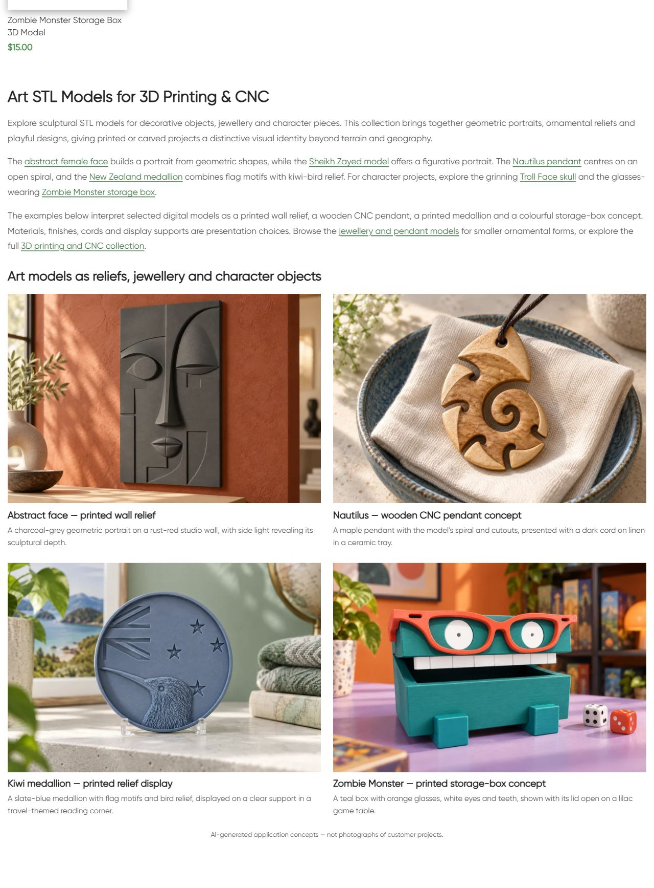
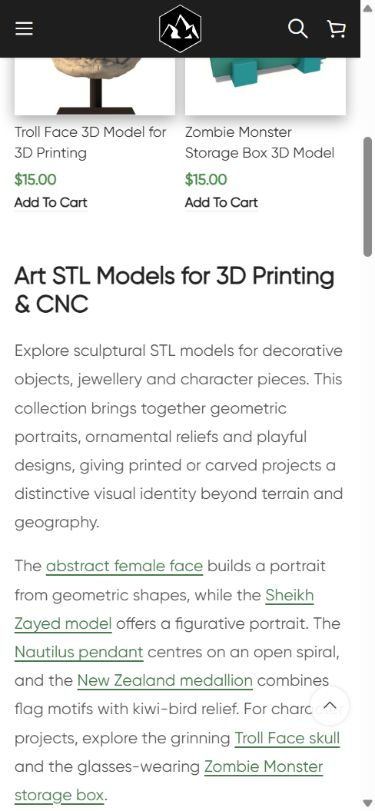

# Live QA — Art

По поручению владельца продолжить категории и менять интерьер/физические примеры опубликован новый нижний block22822/term245. Один H1 **Art STL Models for 3D Printing & CNC**, три абзаца, восемь contextual endpoints, четыре новые пары image/title с matching product links и AI disclosure. Опубликовано 11.10.2026 18:14:18 МСК. Категория содержит шесть товаров; новая copy описывает geometric/figurative portraits, ornamental reliefs и character objects. Existing Other name/URL and Art navigation preserved.

## Новые примеры

- Abstract Female Face16812 — charcoal print/geometric wall relief на rust-red studio wall; исходная асимметрия глаз, центральный нос, губы и линейные формы сохранены визуально.
- Nautilus18721 — maple CNC pendant concept/dark cord/linen-blue ceramic tray; исходный open spiral, edge cutouts и existing cord hole.
- Kiwi21381 — slate-blue printed circular medallion/clear support/green reading corner; kiwi head/long leftward beak, flag geometry и четыре stars сохранены.
- Zombie20199 — teal plastic print/orange glasses/white eyes and teeth/open lid/lilac board-game table; прямоугольный корпус и ноги как в исходной карточке.

Все шесть карточек freshly read HTTP200, H1/excerpt/body/sourceURLs в [product-reference-qa.json](product-reference-qa.json). Четыре original renders просмотрены до генерации. Встроенный **image_gen.imagegen**, отдельная генерация каждого reference-based product mockup, exact prompts/absolute refs/generated paths/mode сохранены в [image-prompts.json](image-prompts.json). Новые изображения просмотрены и сравнены с рендерами. Подставки,cord/material/finish — дополнительное оформление, не комплект физического товара. Visible AI label, customer projects не заявлены. STL метрическая точность, реальное изготовление/fit,лицензии/совместимость не проверены и не обещаны. Каждый WebP1536×1024; PIL только RGB/WebPquality88 conversion. PNG originals retained.

| Пример | Новое attachment | Файлы |
|---|---|---|
| female-face |22823 |[WebP](assets/art-category-female-face-20261011.webp) / [PNG](assets/female-face-original.png) |
| nautilus |22824 |[WebP](assets/art-category-nautilus-20261011.webp) / [PNG](assets/nautilus-original.png) |
| kiwi-medallion |22825 |[WebP](assets/art-category-kiwi-medallion-20261011.webp) / [PNG](assets/kiwi-medallion-original.png) |
| zombie-box |22826 |[WebP](assets/art-category-zombie-box-20261011.webp) / [PNG](assets/zombie-box-original.png) |

## Исходники и публикация

GitHub SSH/main/fetch/upstream0:0 confirmed; unrelated dirty preserved. Source **81f0c4e9a3e74b1e8dfc5ebb9cd2f3c7ff810c0e** pushed, exact archive SHA256 **ff6906cc5b3820edf78ecf9fddf05b0edb95d201df5a4ead9fa4008cbfc7904b** совпал на remote. External target https://shustrik-maps.com, established WireGuard vpsadmin@10.66.66.1/sudoDocker/existing WordPress container. Source `/tmp/art-category-81f0c4e9a3e7`. PHP lint/preview/hash/scope guards passed. Backup before creation/import, apply once, conditional SQL draft→publish/content and placement transaction. Только две новые category bottom metadata keys; no existing category data removed. CLI512MiB only, permanent configuration unchanged. Installed block content SHA256 **bf9827aac4832dce4cf49a8d3f9fda36929c90df718f052460cff7faba3c7b23**.

## Проверки

| Проверка | Результат | Evidence |
|---|---|---|
| HTTP/health |Category/home/cart200; emptycheckout→cart200 |public-qa.json |
| H1/body |Один новый H1, три paragraphs, четыре image/title pairs, AI disclosure |public-qa.json/screenshots |
| SEO |Title/meta/canonical/robots exact baseline preserved |public-baseline.json/public-qa.json |
| Schema |Types/mechanism preserved; full validation вне scope |public-qa.json |
| Catalogue |Все шесть card URLs/titles/prices exact; pagination absent |public-qa.json |
| References |Шесть current cards HTTP200/H1/details; четыре originals inspected |product-reference-qa.json/image-prompts.json |
| Links |Восемь unique endpoints200; examples go to matching products |public-qa.json |
| Media |Четыре HTTP200/alt/hash/dimensions, loaded/opacity1 desktop/mobile |verify.json/browser-qa.json |
| Responsive |1280px two columns;390px one; overflowfalse; screenshots inspected |browser-qa.json |
| Protected DB |Six product posts/all metadata except generated CSS cache,term245 except two new placement fields,seven previous blocks14417/21177/21176/21175/21178/21162/22817 exact |baseline.json/verify.json |
| Runtime |SSH/sudoDocker available;WP/DBrunning/restarts0/StartedAt2026-08-28 unchanged |runtime-after.json |
| Rollback |Guarded preview passed; actual rollback not executed |rollback-preview.json |

First public request received old page cache; final public/browser checks use refreshed version. No repeat apply/global cache purge/build/restart. Mobile screenshots captured as native viewport sequence; all four examples checked. Orders/payments0, GEThealth не подтверждает оплату. SEO uplift/index update/actual fabrication/full schema validation/purchase processing/consent не проверялись. P1 analytics/recovery/consent,yellow/degraded,priority и paid guard03fc676 retained. Other projects not attested.

## Резервная копия

Backup `_shustrik_art_category_backup_20261011`, media journal `_shustrik_art_category_media_20261011`. WordPress container command: `php -d memory_limit=512M /tmp/art-category-81f0c4e9a3e7/release.php --rollback`. Exact content/placement/protected-state guards. Восстанавливается отсутствие двух newly-created placement keys, новый block/media retained. После отката — public QA.

## Скриншоты

[Face](published-mobile-first.png) · [Pendant](published-mobile-middle.png) · [Medallion and box](published-mobile-last.png) · [Box and AI disclosure](published-mobile-box.png)
