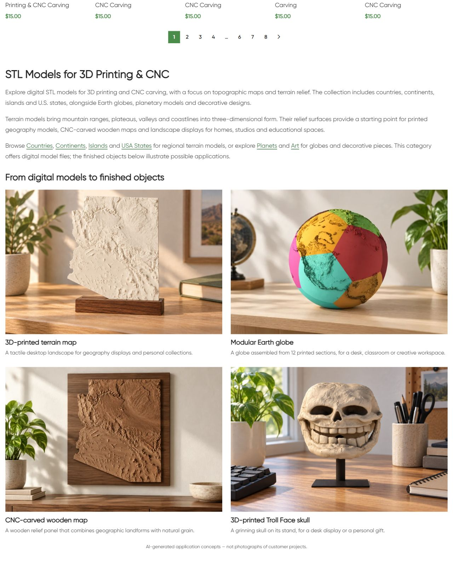
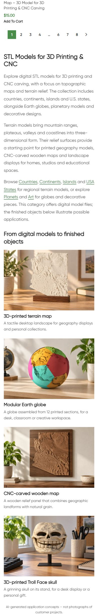

# CNC category — опубликовано и проверено

Владелец одобрил описание и примеры, попросил приблизить их к карточкам товаров, затем заменить декоративное панно на Troll Face и внести изменения на сайт. Изменён только нижний HTML block 14417 категории term 16. Shared usage check: блок относится только к этой категории. Публикация выполнена один раз 11.10.2026 в 13:53:12 МСК.

Опубликованы H1 **STL Models for 3D Printing & CNC**, три абзаца описания с шестью контекстными ссылками и четыре примера: печатная Arizona, модульный сферический Earth, фрезерованная Arizona из дерева, Troll Face skull на подставке. Изображения и заголовки ведут к соответствующим товарам. На странице указано, что это AI-generated application concepts. USA States остаётся draft; title/meta из прежнего brief не публиковались.

## Source, assets and delivery

Source commit **8e3945d758e996ec70b3c95b9e8bfd4993d71526** pushed/main/upstream 0:0 перед доставкой. Точный Git archive SHA256 **7a5f7981f87c43f8c3bcc73c5bc00ebb3990ea6581087b852a8d5db8de884c6c** проверен после передачи. Цель deployment_mode external: https://shustrik-maps.com, установленный WordPress через WireGuard vpsadmin@10.66.66.1, container shustrik-maps-wordpress-1, source `/tmp/cnc-category-8e3945d758e9`. PHP lint и guarded preview прошли; первая LF/CRLF попытка была отклонена до production mutation.

Новые WebP1536×1024: globe attachment22805 и walnut Arizona22806. Built-in image_gen использовал оригинальные изображения карточек товаров; точные prompts и reference paths сохранены в [image-prompts.json](image-prompts.json). Оригиналы PNG и WebP в `assets`; prepare.py выполнял только преобразование формата. Печатная Arizona22053 и Troll22779 — существующие иллюстрации из карточек. Геометрия приближена к референсам, проверка реальных STL/manufacturing accuracy не проводилась.

Точный HTML: [category.html](category.html). Установленный block content SHA256 **856f427892958573be1c927a7200a9e0b9517a58a3e614dbcd8d1719ac83b72c**. Источник сайта — source commit выше; отдельный evidence commit не требует повторного apply.

## Live QA

| Проверка | Результат |
|---|---|
| Category HTTP, self canonical, robots | 200; canonical прежний; index/follow |
| H1 / блок / старый текст | Один H1; новый блок виден; прежний текст заменён |
| Title/meta, schema types | Прежние значения сохранены; наличие schema не означает полную валидацию |
| Товары, цены, пагинация | 25 карточек первой страницы дословно сохранены; вторая страница200/25карточек |
| Ссылки | 9 уникальных контекстных/product endpoints200; Troll link в фото и заголовке |
| Изображения | 4/4 HTTP200, alt заполнены, фактически загружены в браузере |
| Desktop1280 / mobile390 | Две / одна колонка, overflow отсутствует, все4изображения загружены |
| Protected DB state | Term/taxonomy/meta и выбранные товары сохранены по hashes |
| Home/cart/empty checkout | 200/200/redirect cart200; реальные заказы и платежи0 |
| Runtime | SSH/sudoDocker available; WP/DBrunning/restart0; StartedAt прежние; build/restart не требуется |
| Rollback preview | Guarded проверка прошла |

Доказательства: `public-baseline.json`, `public-qa.json`, `browser-qa.json`, `verify.json`, `runtime-after.json`, `rollback-preview.json` в release folder репозитория. Проверка SEO-роста, GSC index update и настоящей оплаты этим выпуском не выполнялась. P1 analytics/recovery/consent и yellow/degraded сохранены. Остальные приложения не аттестованы.

## Rollback

Backup исходного блока в WordPress option `_shustrik_cnc_category_backup_20261011`; journal импортированных media `_shustrik_cnc_category_media_20261011`. Guard проверяет установленный content hash и защищённое состояние. Для отката использовать сохранённый source `php /tmp/cnc-category-8e3945d758e9/release.php --rollback` внутри контейнера WordPress через established SSH/sudoDocker, затем повторить public QA. Откат восстанавливает только прежний block; media сохраняются. Откат сейчас не выполнялся.

## Опубликованная страница

