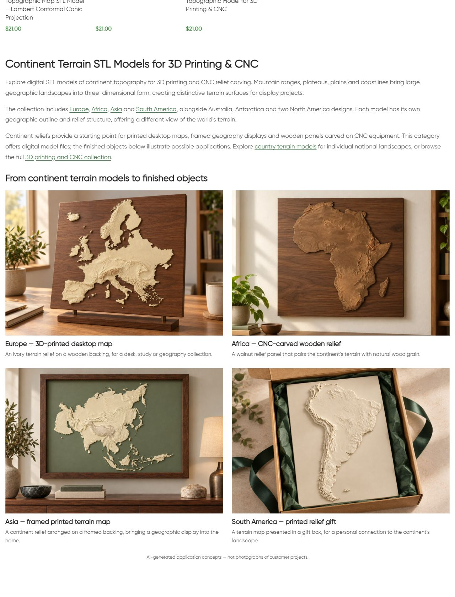
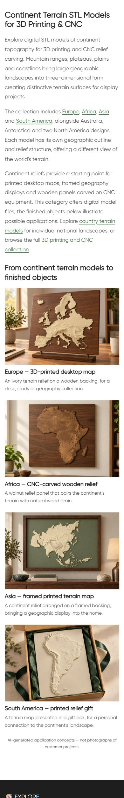

# Live QA — Continents

Опубликован нижний HTML block21175 категории product_cat32 по поручению владельца продолжить workflow следующей категории. Дата: 11.10.2026 16:46:32 МСК. Новый H1 **Continent Terrain STL Models for 3D Printing & CNC**, три описательных абзаца, шесть контекстных ссылок и четыре примера: Europe — печатная настольная карта, Africa — деревянный CNC-рельеф, Asia — печатная карта в рамке, South America — печатный подарочный рельеф. Каждая иллюстрация и её заголовок ведут в соответствующую карточку товара.

## Изображения

Новая Africa создана встроенным **image_gen.imagegen** по двум просмотренным исходным рендерам товара. Сохранены контур, северная ориентация, невысокий рельеф и Madagascar на отдельной сплошной подложке: [PNG](assets/africa-walnut-original.png), [WebP для сайта](assets/continents-category-africa-walnut-20261011.webp), [точный prompt и references](image-prompt.json). WebP1536×1024/235392bytes; PIL использован только для преобразования формата. Attachment22808. Три существующих изображения из карточек: Europe22141, Asia22154, South America22344. Исходные рендеры и иллюстрации всех четырёх выбранных товаров просмотрены. На странице присутствует AI disclosure; изображения — концепции применения, не фотографии customer projects. Фактическое изготовление по STL не проверялось.

## Исходники и публикация

GitHub SSH remote/main/fetch/HEAD/upstream0:0 проверены; прежние unrelated dirty сохранены. Source **cb9903532afd3819db8f46ccbd2e2bf915214adc** pushed. Доставлен exact Git archive SHA256 **fb23f89c92f20c922a82b0f517cd5798a94f33641c74cbaa245b5345dbb94087**; hash на сервере совпал. External target https://shustrik-maps.com через established WireGuard vpsadmin@10.66.66.1, существующий container shustrik-maps-wordpress-1. Source `/tmp/continents-category-cb9903532afd`. PHP lint, single-term shared-usage check, protected hashes и guarded preview прошли. Backup сохранён до import/write; apply выполнен один раз. Installed block SHA256 **3ce8bfce5422acf8805180874e4bd6a894a00158f00a10a87b672d7a6f7fed33**.

## Проверки

| Проверка | Результат | Доказательство |
|---|---|---|
| Category/home/cart HTTP |200; пустой checkout→cart200 |public-qa.json |
| H1/body |Один новый H1, новый блок, старое описание удалено |public-qa.json / screenshots |
| SEO title/meta/canonical/robots |Exact baseline values сохранены |public-baseline.json / public-qa.json |
| Schema |Types и mechanism сохранены; полная schema validation вне scope |public-qa.json |
| Каталог |Все восемь карточек, URL, заголовки и цены exact; пагинации нет |public-qa.json |
| Ссылки |Шесть unique endpoints200; четыре image/title pairs корректны |public-qa.json |
| Media |Четыре HTTP200/alt; все loaded desktop/mobile; новый file hash/dimensions exact |verify.json / browser-qa.json |
| Desktop/mobile |1280px — две колонки,390px — одна; горизонтального overflow нет |browser-qa.json / screenshots |
| Protected DB |Term/block metadata, восемь products, CNC/USA/Countries blocks14417/21177/21176 hashes сохранены |baseline.json / verify.json |
| Runtime |SSH/sudoDocker available; WP/DBrunning/restarts0/StartedAt прежние |runtime-after.json |
| Rollback |Guarded preview passed; откат не выполнялся |rollback-preview.json |

Первый запрос получил старую page-cache версию. После background refresh final public/browser QA passed; повторного apply, build/restart или global cache purge не выполнялось. Desktop и mobile screenshots просмотрены.

SEO uplift, реальная fabrication, purchase processing и consent не проверялись этой контентной публикацией. Orders/payments0; GET health не является проверкой оплаты. P1 analytics/recovery/consent, yellow/degraded, priority и paid guard source03fc676 сохранены. Другие проекты не аттестованы.

## Резервная копия и откат

Backup `_shustrik_continents_category_backup_20261011`, media journal `_shustrik_continents_category_media_20261011`. Условный откат через `php /tmp/continents-category-cb9903532afd/release.php --rollback` внутри того же WordPress container через SSH/sudoDocker. Guard проверяет installed content/protected hashes, возвращает прежний блок и сохраняет media. После отката нужна публичная проверка.

## Опубликованная страница

