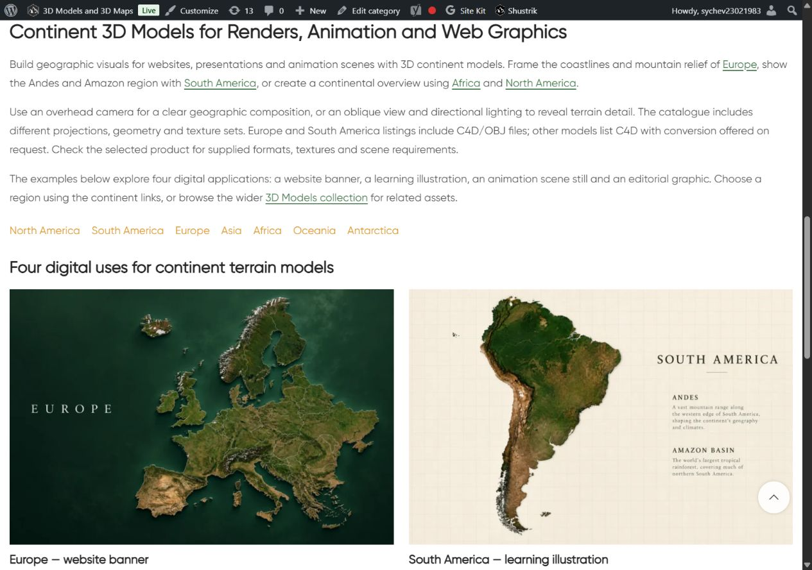

# Continents — описание и цифровые примеры

По поручению владельца продолжена следующая категория: Continents term63,13 моделей. Правило «одна модель — только текст» сохранено для следующих подходящих категорий. Создан dedicated bottom block **22867**: один H1, три абзаца, семь ссылок навигации по материкам, четыре товара и root3D Models (12 уникальных направлений). Четыре новых примера:

- Europe — website banner — https://shustrik-maps.com/product/europe-3d-model/
- South America — learning illustration — https://shustrik-maps.com/product/3d-map-of-south-america-c4d-model/
- Africa — animation scene still — https://shustrik-maps.com/product/3d-model-of-africa-relief/
- North America — editorial graphic — https://shustrik-maps.com/product/north-america-3d-model/

Тексты ориентированы на digital renders, анимационные сцены, иллюстрации сайтов и обучение. Форматы отличаются: Europe/South America C4D/OBJ, остальные выбранные C4D с conversion on request.13 свежих карточек HTTP200, характеристики в product-reference-qa.json. Исходные изображения четырёх товаров просмотрены до built-in image_gen.imagegen; промпты/пути в image-prompts.json. Силуэты, цвета рельефа и основные географические признаки визуально сопоставлены. Сцены/свет/layout являются AI-концепциями; анимационный пример — still image. Visible AI disclosure и alt добавлены. Готовые сцены/анимация, универсальная совместимость, лицензия или научная точность не обещаются. Оригинальные PNG и references сохранены; PIL использован только для RGB/WebP88 преобразования, четыре1536×1024assets.

Исходный block14991 используется в term63.description и трёх nav_menu_items18211/20008/20525. Это подтверждено фактическим WordPress shortcode parser; прочие совпадения цифр — CSS timestamps. **Block14991 и все три menu items сохранены.** Только category description reference `[html_block id="14991"]` заменён на пустое значение, а два bottom placement meta подключены к новому block. Семь прежних navigation destinations сохранены в новом HTML. Остальные term fields/meta,13 product states (кроме generated CSS cache),18 прежних CMS blocks и три menu items (21 protected posts),North Pole term67 и South Pole term68 защищены хешами.

GitHub-first: fetch/SSH remote/main/HEAD/upstream0:0 проверены; шесть посторонних modified и прежние untracked сохранены. Source **a2c82cded07cb0df916feaf24d0f476d63749ced** pushed до CMS. Exact archive SHA256 **c1e5d1843db574a74b66effbcecdd0f054c86031f248b8a9a63b8b6d99d0defb** проверен на сервере. External target https://shustrik-maps.com, WireGuard vpsadmin@10.66.66.1/sudoDocker, source `/tmp/continents-digital-a2c82cded07c`. PHP lint/preview прошли; apply один раз **2026-10-12T07:09:28+00:00**, conditional SQL transaction для нового блока и category-only description, guarded placement meta. Backup/journal созданы до import. Attachments **22868,22869,22870,22871**. SHA256 installed content **4680d510bef4445628950e1c33bc85e9f1c0f9162bb4b45d27001155fe54f53d**. CLI512MiB — только разовый процесс; persistent config/build/restart не менялись.

Public QA: category/home/cart200, empty checkout→cart200, 12 destinations200,4media200/alt/hash/dimensions. Title/description meta/canonical/robots/schema types,13 карточек/цен/URL и отсутствие pagination сохранены. Один H1, четыре изображения/eight article anchors/disclosure подтверждены. Первое публичное чтение получило кеш без нового блока; проверочный скрипт получил защиту от отсутствующего узла, повторное чтение прошло. Повторного apply не было; QA helper-only correction не меняет CMS source.

Browser Chrome: desktop1280×900 two columns/mobile390×844 one column, horizontal overflow отсутствует, все4images loaded/opacity1. Native screenshots после keyboard scrolling; первоначальный full-page capture был непригоден и сохранён отдельно в .codex-work, в отчёт включены проверенные viewport captures. Verify/rollback-preview passed; фактический rollback не выполнялся. Runtime 12.10.2026 10:18 МСК: SSH/sudoDocker available, WP/DBrunning, restarts0/StartedAt2026-08-28 unchanged. P1 consent/recovery/analytics,yellow/degraded,priority/high и paidguard03fc676 сохранены. Orders/payments не выполнялись; SEO uplift/indexing и full schema validation не аттестованы.

Rollback backup `_shustrik_continents_digital_backup_20261012`. В WP container: `php -d memory_limit=512M /tmp/continents-digital-a2c82cded07c/release.php --rollback`. Условно восстанавливает исходные term63 description reference и text/empty bottom placement, сохраняет original/shared block и новые media/block для recoverability; затем проверить public page.

[Четыре примера](published-desktop.jpg) · [Нижняя часть](published-desktop-last.jpg)

[Mobile heading](published-mobile-heading.png) · [Europe](published-mobile-first.png) · [South America](published-mobile-middle.png) · [Africa](published-mobile-africa.png) · [North America/disclosure](published-mobile-last.png)
