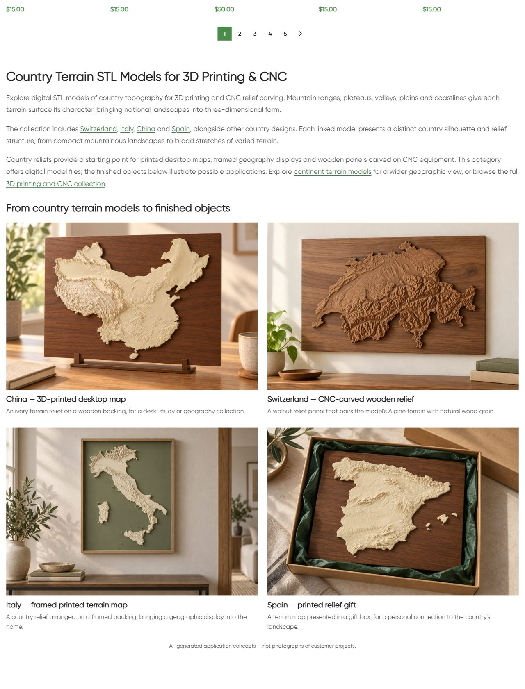
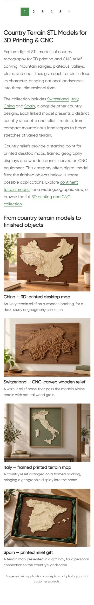

# Live QA — Countries

## Scope and evidence date

Владелец поручил перейти к следующей категории после публикации CNC и USA States. Countries — следующий выбранный раздел. 11.10.2026 16:28:29 МСК опубликован только нижний HTML block21176 категории term17: H1 **Country Terrain STL Models for 3D Printing & CNC**,3абзаца описания,6контекстных ссылок и4примера изделий. Shared usage check подтвердил единственную category reference и отсутствие shared post/meta references.

Примеры: China — печатная настольная карта; Switzerland — walnut CNC relief; Italy — печатный рельеф в рамке; Spain — printed relief gift. Фото и заголовки ведут в соответствующие карточки. Все4товара входят в term17. Title/meta,canonical,robots,taxonomy,каталог,цены,пагинация,содержимое товаров и предыдущие blocks14417/21177 сохранены. Неподтверждённые универсальные body claims старого блока заменены профессиональным описанием без обучающих секций. Product card claims этим выпуском не редактировались.

## Images and prompt

Switzerland создана встроенным **image_gen** по двум исходным рендерам карточки, просмотрена и сверена визуально: [PNG original](assets/switzerland-walnut-original.png), [WebP для сайта](assets/countries-category-switzerland-walnut-20261011.webp), [точный финальный prompt и reference paths](image-prompt.json). WebP1536×1024/338388bytes; PIL использован только для преобразования формата. Новый attachment22807; reuse China22129/Italy22094/Spain22099. Существующие иллюстрации и исходные country renders просмотрены; геометрия иллюстраций приближена к референсам, но фактическая точность manufacturing/STL не проверялась. На странице явно указаны AI-generated application concepts, не customer-project photographs.

## Source and delivery

GitHub SSH/main/fetch/upstream0:0 проверены перед изменением; прежние unrelated dirty сохранены. Source **73a81bfa9b4f4bc385951f6e8c980d0b91a89c42** pushed и доставлен exact Git archive SHA256 **31998251fffb9c6e6286f1c9bfdb06982c506159769790657f7e7dc3cd71f16b**, после передачи hash совпал. External target https://shustrik-maps.com; established WireGuard vpsadmin@10.66.66.1; container shustrik-maps-wordpress-1; source `/tmp/countries-category-73a81bfa9b4f`. PHP lint и guarded preview прошли перед apply, conditional SQL write выполнен один раз. Installed block SHA256 **f0d3b226a68c9423faa26d7b737c7d1b5a332214df675367625447f882df7e90**.

## Checks

| Check | Expected | Observed | Result | Evidence |
|---|---|---|---|---|
| HTTP |200 |Category/home/cart200;emptycheckout→cart200 |Passed |public-qa.json |
| Canonical/robots |Preserve |Self canonical и index/follow прежние |Passed |public-baseline.json / public-qa.json |
| H1/body |One new H1 |Один H1,новый block,старый body заменён |Passed |category.html / screenshots |
| Title/meta |Preserve |Exact baseline values |Passed |public-qa.json |
| Schema |Preserve mechanism |Types unchanged;presence check,full validation outside scope |Passed within scope |public-qa.json |
| Catalogue/prices/pagination |Preserve |25cards/prices первой страницы exact;page2HTTP200/25cards |Passed |public-qa.json |
| Links |200 / correct URLs |6unique endpoints200;4photo+title pairs |Passed |public-qa.json |
| Media |4images / alt / load |4/4HTTP200/alt/loaded desktop/mobile;new file hash/dimensions exact |Passed |verify.json / browser-qa.json |
| Desktop/mobile |2/1columns,no overflow |1280px2columns;390px1column;overflowfalse |Passed |browser-qa.json |
| Protected DB |Unchanged |Term/meta,4products,CNC+USA blocks hashes preserved |Passed |verify.json |
| Runtime |Running |SSH/sudoDocker available;WP/DBrunning/restarts0/StartedAt unchanged |Passed |runtime-after.json |
| Rollback |Guarded readiness |Previewpassed,not executed |Passed |rollback-preview.json |

## Defects, unknowns and next action

Первый публичный запрос показал прежнюю page-cache версию. После background refresh final public и browser checks прошли; дополнительных cache mutations, build/restart и повторного apply нет. Public QA check удаления старого body уточнён по видимому heading, поскольку bold markup разбивает raw byte phrase; это evidence-only correction и не меняет installed source.

Orders/payments0; GET commerce health не является проверкой реальной оплаты. SEO uplift/index update/processed purchase и реальная fabrication не измерены. P1 analytics/recovery/consent,yellow/degraded и priority сохранены; paid guard source03fc676. Другие приложения не аттестованы. Текущая контентная публикация завершена.

## Backup and rollback

Backup option `_shustrik_countries_category_backup_20261011` сохранён перед import/write; journal `_shustrik_countries_category_media_20261011`. Откат: `php /tmp/countries-category-73a81bfa9b4f/release.php --rollback` внутри того же WordPress container через established SSH/sudoDocker, затем public QA. Guard проверяет installed content и protected hashes; возвращается прежний block,media сохраняются. Rollback-preview passed, откат сейчас не выполнялся.

## Published screenshots

