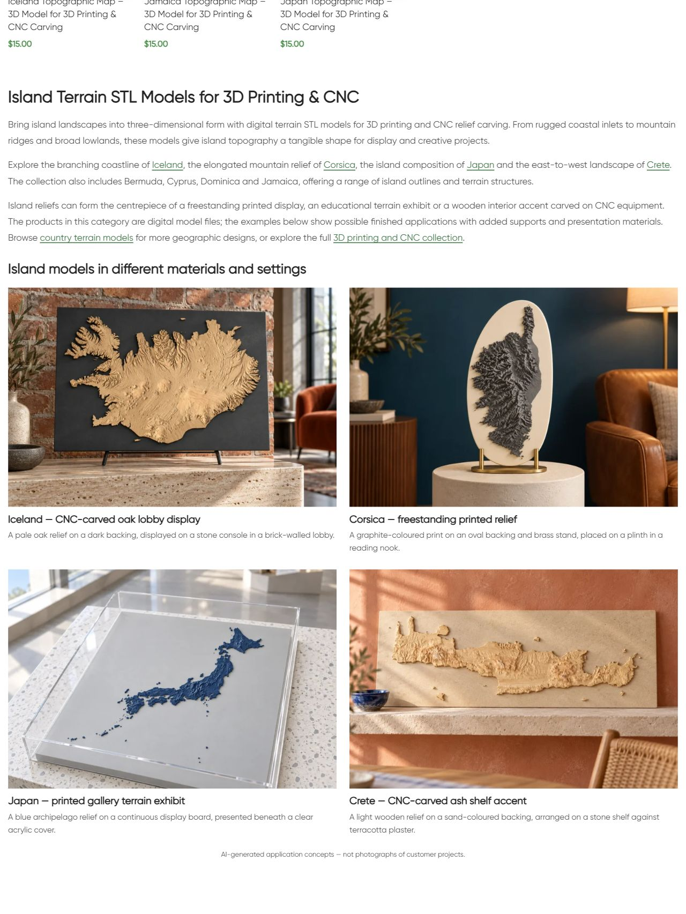
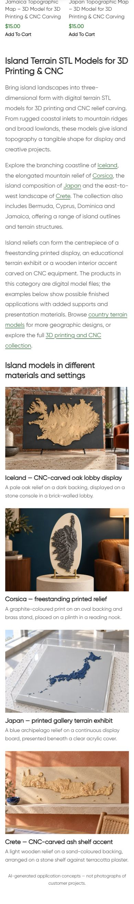

# Live QA — Islands

По поручению владельца продолжить следующий раздел и менять интерьер или физические изделия обновлён нижний block21178 категории term27. Опубликовано 11.10.2026 16:59:49 МСК. Один H1 **Island Terrain STL Models for 3D Printing & CNC**, три описательных абзаца, шесть контекстных ссылок и четыре новых reference-based примера. Иллюстрации и заголовки ведут в соответствующие карточки.

## Четыре новых примера

- Iceland: CNC-рельеф светлого дуба на тёмной подложке, каменная консоль в гостиничном лобби с кирпичной стеной.
- Corsica: графитовый печатный рельеф на овальной подложке и латунной подставке, постамент в комнате с синей стеной и кожаным креслом.
- Japan: синий печатный архипелаг на общей подложке под прозрачным колпаком, светлая музейная галерея.
- Crete: CNC-рельеф ясеня на песочной подложке, каменная полка у терракотовой стены средиземноморской столовой.

Все четыре изображения созданы встроенным **image_gen.imagegen**, по одному исходному рендеру соответствующего товара. Reference files, точные prompts и mode сохранены в [image-prompts.json](image-prompts.json). Сгенерированные изображения просмотрены и сверены с референсами: сохранены характерные контуры, ориентация, размещение островов и неглубокий рельеф; фактическая STL/manufacturing точность не проверялась. Подставки, подложки и колпак — дополнительное оформление, не включение в цифровой файл. На странице явная подпись AI-generated application concepts, не customer project photographs. Каждый WebP1536×1024; PIL использован только для конвертации в RGB/WebPquality88.

| Модель | Новое attachment | Сохранённые файлы |
|---|---|---|
| Iceland |22809 |[WebP](assets/islands-category-iceland-20261011.webp) / [PNG](assets/iceland-original.png) |
| Corsica |22810 |[WebP](assets/islands-category-corsica-20261011.webp) / [PNG](assets/corsica-original.png) |
| Japan |22811 |[WebP](assets/islands-category-japan-20261011.webp) / [PNG](assets/japan-original.png) |
| Crete |22812 |[WebP](assets/islands-category-crete-20261011.webp) / [PNG](assets/crete-original.png) |

## Исходники и публикация

GitHub SSH/main/fetch/HEAD/upstream0:0 проверены; unrelated dirty сохранены. Source **e8f6cc007401b98cbb0445d3aa5864a97679577a** pushed. Exact Git archive SHA256 **ce369510b37eb972376bbfaa1a72d7d166e80bfb8bf4f49eb3bd6d939105e442** совпал после передачи. External target https://shustrik-maps.com, established WireGuard vpsadmin@10.66.66.1, existing WordPress container. Source `/tmp/islands-category-e8f6cc007401`. PHP lint, single-term shared-usage check, hashes, preview прошли. Backup до import/write, apply один раз, conditional write. Installed content SHA256 **ad956f4ac3ee3c351e08dea817d0b2dda84f501de8ed99d2ae8cdefbfc40baed**.

## Проверки

| Проверка | Результат | Доказательство |
|---|---|---|
| HTTP |Category/home/cart200; пустой checkout→cart200 |public-qa.json |
| H1/body |Один новый H1, блок присутствует, старый body заменён |public-qa.json / screenshots |
| SEO title/meta/canonical/robots |Exact baseline values сохранены |public-baseline.json / public-qa.json |
| Schema |Types/mechanism сохранены; full validation вне scope |public-qa.json |
| Каталог |Все восемь карточек/URL/заголовков/цен exact, пагинации нет |public-qa.json |
| Product references |Четыре выбранные карточки HTTP200, H1/source media recorded, original renders inspected |product-reference-qa.json |
| Links/CTA |Шесть unique endpoints200, четыре photo/title pairs корректны |public-qa.json |
| Media |Четыре HTTP200/alt, loaded desktop/mobile, file hash/dimensions exact |verify.json / browser-qa.json |
| Desktop/mobile |1280px две колонки,390px одна, overflowfalse; screenshots inspected |browser-qa.json |
| Protected DB |Восемь products,term/block meta, прежние blocks14417/21177/21176/21175 hashes сохранены |baseline.json / verify.json |
| Runtime |SSH/sudoDocker available,WP/DBrunning/restarts0/StartedAt прежние |runtime-after.json |
| Rollback |Guarded preview passed, откат не выполнялся |rollback-preview.json |

Первый публичный запрос получил старую page-cache версию. После background refresh final checks passed; повторного apply,global cache purge,build/restart нет. Orders/payments0. GET health не подтверждает оплату. SEO uplift/index update, фактическое изготовление,purchase processing и consent не проверялись. P1 analytics/recovery/consent,yellow/degraded,priority и paid guard source03fc676 сохранены. Другие проекты не аттестованы.

## Резервная копия

Backup `_shustrik_islands_category_backup_20261011`, media journal `_shustrik_islands_category_media_20261011`. Условный откат: `php /tmp/islands-category-e8f6cc007401/release.php --rollback` внутри того же WordPress container через SSH/sudoDocker. Guard проверяет installed content/protected hashes; восстанавливается прежний блок, media сохраняются. После отката — публичная проверка.

## Опубликованная страница

