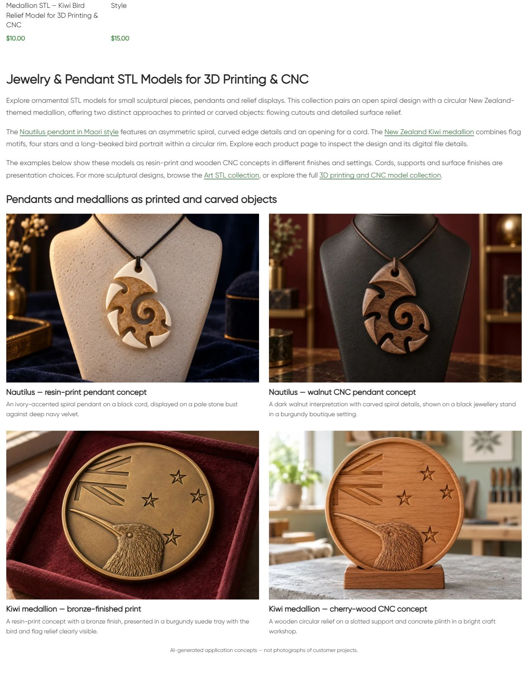
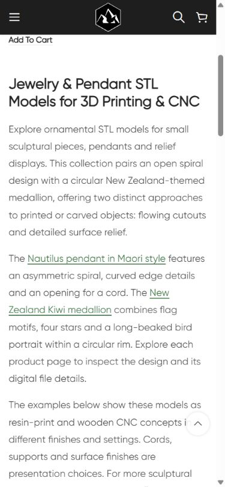

# Live QA — Jewelry & Pendant

По поручению владельца продолжить категории с другими интерьерами и физическими примерами опубликован нижний block22827/term246. Один H1 **Jewelry & Pendant STL Models for 3D Printing & CNC**, три абзаца, четыре distinct contextual endpoints, четыре linked image/title pairs и visible AI disclosure. Опубликовано 11.10.2026 18:46:04 МСК. Два товара: Nautilus18721 и Kiwi21381; карточки прочитаны заново, исходные рендеры просмотрены.

## Новые примеры

- Nautilus resin-print — ivory accents/black cord/stone bust/navy velvet.
- Nautilus CNC concept — dark walnut/brown cord/black jewellery stand/burgundy boutique.
- Kiwi resin-print — bronze finish/burgundy suede tray.
- Kiwi CNC concept — cherry wood/slotted support/concrete plinth/bright workshop.

Визуально сохранены asymmetric Nautilus spiral/top hole/edge notches и Kiwi circular rim/flag motif/four stars/long-beaked head. Kiwi hanging hole/chain не добавлены. Точность STL в миллиметрах и реальное изготовление не проверены. Cords/supports/finishes являются оформлением. Visible AI disclosure отделяет concepts от фотографий изготовленных заказов.

Встроенный **image_gen.imagegen**, отдельная reference-guided генерация каждого изображения. Exact prompts/references/generated paths/mode сохранены в [image-prompts.json](image-prompts.json); детали двух product pages — [product-reference-qa.json](product-reference-qa.json). Четыре новых изображения просмотрены. PNG originals retained; PIL только RGB/WebP88 conversion,1536×1024. Никаких гарантий machining/compatibility/licensing не добавлено.

| Пример | Новое attachment | Файлы |
|---|---|---|
| nautilus-print | 22828 | [WebP](assets/jewelry-category-nautilus-print-20261011.webp) / [PNG](assets/nautilus-print-original.png) |
| nautilus-cnc | 22829 | [WebP](assets/jewelry-category-nautilus-cnc-20261011.webp) / [PNG](assets/nautilus-cnc-original.png) |
| kiwi-print | 22830 | [WebP](assets/jewelry-category-kiwi-print-20261011.webp) / [PNG](assets/kiwi-print-original.png) |
| kiwi-cnc | 22831 | [WebP](assets/jewelry-category-kiwi-cnc-20261011.webp) / [PNG](assets/kiwi-cnc-original.png) |

## Исходники и публикация

GitHub SSH/main/fetch/upstream0:0 проверены; unrelated dirty сохранены. Source **70e1d62ee3594aef1723571446feb2859303dace** pushed; exact archive SHA256 **aed1fd4cdad3aa0b4da18859d38c17f2a753f7eb39f86371061c12971f03990c** совпал на remote. External target https://shustrik-maps.com, WireGuard vpsadmin@10.66.66.1/sudoDocker/existing WordPress container, source `/tmp/jewelry-category-70e1d62ee359`. PHP lint/preview/scope/hash guards passed. Backup/journal before creation/import, apply once; conditional SQL draft→publish/exact content and placement transaction. Только новый block, четыре media и две previously absent bottom placement metadata keys. CLI512MiB only; no build/restart or persistent configuration edit. Installed content SHA256 **4df2d69c0825dca95e7ca1d80eb1d3afb913937df72877b5894ff92a763f495b**.

## Проверки

| Проверка | Результат | Evidence |
|---|---|---|
| HTTP/health |Category/home/cart200; emptycheckout→cart200 |public-qa.json |
| H1/copy |Один H1,три paragraphs,four image/title pairs,AI disclosure |public-qa.json/screenshots |
| SEO |Exact title/meta/canonical/robots baseline preserved |public-baseline.json/public-qa.json |
| Catalogue |Two URLs/titles/prices preserved,no pagination |public-qa.json |
| Schema |Existing types preserved; full validation вне scope |public-qa.json |
| Links/media |Four unique endpoints200;four images200/alt/hash/dimensions |public-qa.json/verify.json |
| Responsive |Desktop1280 two columns;mobile390 one;no overflow;all loaded/opacity1 |browser-qa.json |
| Protected DB |Term246 except new placement,2 product states except generated CSS cache,eight previous blocks exact |baseline.json/verify.json |
| Runtime |SSH/sudoDocker available;WP/DBrunning,restarts0,StartedAt unchanged |runtime-after.json |
| Rollback |Guarded preview passed,actual rollback not executed |rollback-preview.json |

Protected previous blocks14417/21177/21176/21175/21178/21162/22817/22822. Initial public request saw old cache; final public/browser checks used refreshed version. No repeat apply/global purge. Mobile verified using native viewport sequence. Orders/payments0; GEThealth does not validate purchase processing. SEO uplift/indexing update/full schema validation/real fabrication/consent not attested. P1 analytics/recovery/consent,yellow/degraded,priority and paid guard03fc676 retained. Other projects not attested.

## Резервная копия

Backup `_shustrik_jewelry_category_backup_20261011`, media journal `_shustrik_jewelry_category_media_20261011`. В WordPress container: `php -d memory_limit=512M /tmp/jewelry-category-70e1d62ee359/release.php --rollback`. Exact content/placement/protected-state guards; restore absence of two new placement keys,retain new block/media; follow with public QA.

## Скриншоты

[Print and walnut pendants](published-mobile-first.png) · [Bronze medallion](published-mobile-middle.png) · [Wood medallion](published-mobile-last.png) · [AI disclosure](published-mobile-disclosure.png)
