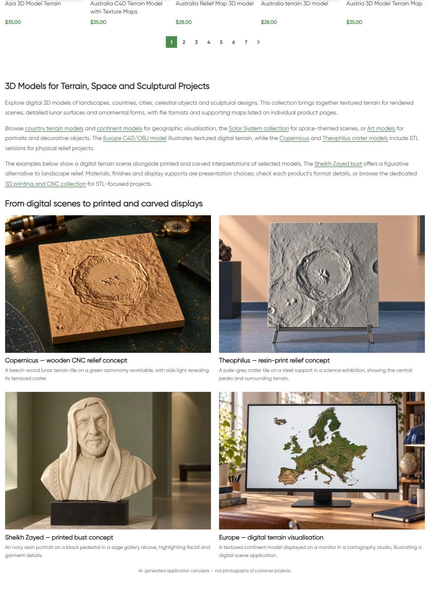
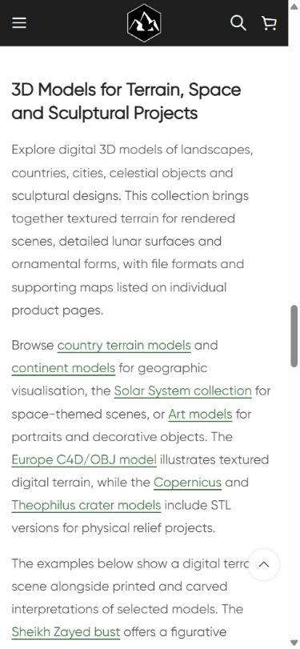

# Live QA — 3D Models

По поручению владельца продолжить категории после завершения CNC ветки опубликован отдельный нижний block22832/term26. Existing page H1 **3D Models** сохранён; bottom H2 **3D Models for Terrain, Space and Sculptural Projects**, три абзаца,nine contextual destinations,four linked example pairs,visible AI disclosure. Каталог173 товара;25 карточек первой страницы и пагинация сохранены.

## Новые примеры

- Copernicus16696 — beech CNC square lunar relief/green astronomy worktable.
- Theophilus16728 — pale-grey resin-print square terrain/steel stand/science exhibition.
- Sheikh Zayed15527 — ivory resin portrait bust/black pedestal/sage gallery alcove.
- Europe10216 — textured digital terrain on monitor/cartography studio.

Четыре карточки freshly read HTTP200; C4D/STL явно указаны для crater models; Sheikh STL tag/print-CNC description; Europe C4D/OBJ shown as digital scene only. Product details/sourceURLs в [product-reference-qa.json](product-reference-qa.json). Original renders просмотрены до генерации и сохранены в references/. Встроенный **image_gen.imagegen**, отдельная reference-guided generation; exact prompts/references/mode/generated paths в [image-prompts.json](image-prompts.json). Новые изображения просмотрены и визуально сравнены с originals: square tiles/crater layouts,portrait attire,Europe coastline/islands. Материалы,постаменты и сцены — оформление. Реальное изготовление и метрическая STL точность не проверены; universal printability/compatibility/license guarantees не добавлены. Suspicious Sheikh size unit не повторяется. PNGoriginals retained; PIL толькоRGB/WebP88conversion,1536×1024.

| Пример | Новое attachment | Файлы |
|---|---|---|
| copernicus-cnc | 22833 | [WebP](assets/models-category-copernicus-cnc-20261011.webp) / [PNG](assets/copernicus-cnc-original.png) |
| theophilus-print | 22834 | [WebP](assets/models-category-theophilus-print-20261011.webp) / [PNG](assets/theophilus-print-original.png) |
| zayed-print | 22835 | [WebP](assets/models-category-zayed-print-20261011.webp) / [PNG](assets/zayed-print-original.png) |
| europe-digital | 22836 | [WebP](assets/models-category-europe-digital-20261011.webp) / [PNG](assets/europe-digital-original.png) |

## Исходники и публикация

GitHub SSH/main/fetch/upstream0:0 confirmed; unrelated dirty preserved. Предпубликационный guard выявил,что original block14416 также referenced в menu items18204/20589; поэтому он сохранён целиком,создан dedicated block22832,и только term26.description reference заменён на `[html_block id="22832"]`. All other term fields/metadata preserved. Menu references `[html_block id="14416"]` unchanged,menu-qa.json. Shared14416 and nine previous blocks protected by full post/meta hashes.

Initial source **8e53c117ad6c8180776655a7d322cd2fc30a2e52**, exact archive SHA256 **245e8ff6ee8c73af4c6a7fa7f35a7978e70e17e90932d53386668d66e73a75a3** совпал на remote; one main apply 11.10.2026 19:10:49 МСК,создан одинblock и четыреmedia. Final source **eb7c44e99768f954addff49019a993ed41e307ec**, archive SHA256 **4aec61156700a41f0a9016ac30e124739fdbc360f7c245f063beb6ba391fb4c2** совпал на remote; heading-only correction H1→H2 19:14:35 МСК after discovering pre-existing top H1. heading-fix.php preview/lint/scope guard подтвердил,что изменение ограничено heading tags; new block/media не создавались. Exact final HTML matches committed category.html after resolving attachment placeholders; installed content SHA256 **50a81c6543b334385defd2116fdd2e0b23d4bde076e005f19d049aa1215f3c60**. No repeat main apply.

External https://shustrik-maps.com via established WireGuard vpsadmin@10.66.66.1/sudoDocker/WordPress container. Final source `/tmp/models-category-eb7c44e99768`. Backup/journal before mutation; conditional SQL block content/reference transaction with concurrency/protected-state guards. CLI512MiB only,no persistent config/build/restart.

## Проверки

| Проверка | Результат | Evidence |
|---|---|---|
| HTTP/health |Category/home/cart200;emptycheckout→cart200 |public-qa.json |
| Headings/copy |One preserved H1,new bottom H2,three paragraphs,four image/title pairs,AI disclosure |public-qa.json/browser-qa.json |
| SEO |Title/meta/canonical/robots exact baseline preserved |public-baseline.json/public-qa.json |
| Catalogue |173 product states protected;25 first-page titles/URLs/prices,pagination preserved |baseline.json/verify.json/public-qa.json |
| Schema |Existing types preserved;full validation внеscope |public-qa.json |
| Links/media |Nine endpoints200;four images200/alt/hash/dimensions |public-qa.json/verify.json |
| Responsive |Desktop1280 two columns;mobile390 one;no overflow;allloaded/opacity1 |browser-qa.json/screenshots |
| Protected CMS |Term26 except description reference,173products except generatedCSScache,shared14416,ninepriorblocks exact |baseline.json/verify.json |
| Menus |18204/20589 still reference original14416 |menu-qa.json |
| Runtime |SSH/sudoDocker available;WP/DBrunning,restarts0,StartedAt unchanged |runtime-after.json |
| Rollback |Guarded preview passed;actual rollback not executed |rollback-preview.json |

Public cache initially served the earlier heading version; final HTTP/browser checks used refreshed content. No global purge/build/restart. Mobile inspected as native viewport sequence. Orders/payments0; GEThealth не подтверждает purchase processing. SEO uplift/index update/real fabrication/full schema validation/consent not attested. P1 analytics/recovery/consent,yellow/degraded,priority and paid guard03fc676 retained. Other projects not attested.

## Резервная копия

Backup `_shustrik_models_category_backup_20261011`, media journal `_shustrik_models_category_media_20261011`. В WordPress container: `php -d memory_limit=512M /tmp/models-category-eb7c44e99768/release.php --rollback`. Exact content/placement/protected guards; restores term26.description to original `[html_block id="14416"]`,retains new22832/media. Shared original/menu never edited. Follow with public QA.

## Скриншоты

[Copernicus](published-mobile-first.png) · [Theophilus and bust](published-mobile-middle.png) · [Bust and Europe](published-mobile-last.png) · [AI disclosure](published-mobile-disclosure.png)
