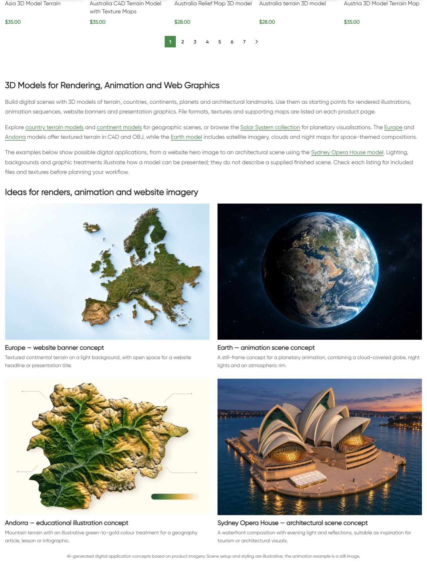

# 3D Models — цифровые примеры

По поручению владельца «Делай» после обсуждения цифровых сценариев обновлён existing dedicated bottom block22832/term26. Новый H2 **3D Models for Rendering, Animation and Web Graphics**, три абзаца,семь contextual destinations,четыре linked image/title pairs. Европа — баннер; Земля — still-frame concept анимации; Андорра — учебная иллюстрация; Sydney Opera House — architectural evening scene. Физические примеры заменены,description соответствует digital workflows. Карточки товаров не редактировались.

## Изображения

Все четыре product pages freshly fetched HTTP200: Europe10216,Earth17205,Andorra20943,Sydney18062. Указаны C4D/OBJ; Earth cloud/night maps,Andorra terrain,Europe satellite/borders,Sydney day/night textures подтверждены карточками. Original product renders просмотрены до reference-guided built-in image_gen generation. Точные prompts,reference paths и source PNG paths: [image-prompts.json](image-prompts.json); fetched details: [product-reference-qa.json](product-reference-qa.json). Original references и PNG сохранены; PIL использовался толькоRGB/WebP88conversion. Четыре1536×1024WebP,alt,caption и visible AI disclosure. Концепции не заявлены exact renders supplied model files,готовыми downloadable scenes,реальной анимацией или numerical elevation map. Географическое/архитектурное сходство визуально проверено; точная geometry/data не аттестована. Andorra palette illustrative,no elevation values. Все physical originals/media retained.

| Пример | attachment | Файлы |
|---|---|---|
| europe-banner | 22837 | [WebP](assets/models-digital-europe-banner-20261011.webp) / [PNG](assets/europe-banner-original.png) |
| earth-animation | 22838 | [WebP](assets/models-digital-earth-animation-20261011.webp) / [PNG](assets/earth-animation-original.png) |
| andorra-education | 22839 | [WebP](assets/models-digital-andorra-education-20261011.webp) / [PNG](assets/andorra-education-original.png) |
| sydney-render | 22840 | [WebP](assets/models-digital-sydney-render-20261011.webp) / [PNG](assets/sydney-render-original.png) |

## Публикация и защита

GitHub-first fetch/SSH/main/upstream0:0 confirmed; six unrelated modified files и untracked сохранены. Source **e5b57eb53ecc5d7a940142a682b3ddbc36c116f1** committed/pushed before CMS mutation. Exact Git archive SHA256 **5b264d4433d12e0803206660ec5c86e1e9915d6a2121df95d60f5cce392e756e** verified remote. External deployment via WireGuard vpsadmin@10.66.66.1/sudoDocker; source `/tmp/models-digital-e5b57eb53ecc`. PHP lint/preview passed,apply once **2026-10-11T17:17:56+00:00**. Conditional SQL transaction updates only block22832 content/modified time after exact before/content and protected state guards; no new block or category placement changes. CLI memory512MiB only,no persistent config/build/restart.

Installed content SHA256 **2253a9bdde318c4e4097380d11acd79360401a7e4866ec7961bfe19151605a57**. Protected173 product post/meta states except generated CSS cache,term26 other fields/meta,term description `[html_block id="22832"]`,block22832 identity/meta,shared14416 and nine prior CNC blocks. Menu18204/20589 unchanged references original14416,menu-qa.json. Actual original raw public HTML snapshots include native whitespace; authored sources pass diff whitespace check.

## Проверки

- Public category/home/cart HTTP200;emptycheckout redirects cart200. Links seven endpoints200,four media200/alt/hash/dimensions.
- Existing title/meta/canonical/robots,one top H1,schema types,25 cards/prices/URLs and pagination preserved;173 product states protected.
- New bottom H2/copy/four photos,eight article anchors,AI disclosure checked. Initial HTTP check saw old cache; fresh check passed without repeated apply or global purge.
- Desktop1280 two columns;mobile390 single column;all four loaded/opacity1,no overflow. Native mobile viewport sequence checked all four and disclosure.
- SSH/sudoDocker available,WP/DBrunning,restarts0,StartedAt2026-08-28 unchanged. Runtime evidence runtime-after.json.
- Verify/rollback-preview passed. Orders/payments0;payment processing,consent,full schema validation,SEO uplift/index updates outside scope. P1 analytics/recovery/consent,yellow/degraded,priority and paid guard03fc676 retained.

## Rollback

Backup `_shustrik_models_digital_backup_20261011`;journal `_shustrik_models_digital_media_20261011`. In WordPress container: `php -d memory_limit=512M /tmp/models-digital-e5b57eb53ecc/release.php --rollback`. Conditional exact content/protected guards restore prior bottom content **50a81c6543b334385defd2116fdd2e0b23d4bde076e005f19d049aa1215f3c60**,retain block/media/category reference. Actual rollback not executed.

## Скриншоты

[Mobile heading](published-mobile-heading.png) · [Europe/Earth](published-mobile-first.png) · [Earth/Andorra](published-mobile-middle.png) · [Sydney/disclosure](published-mobile-last.png)
