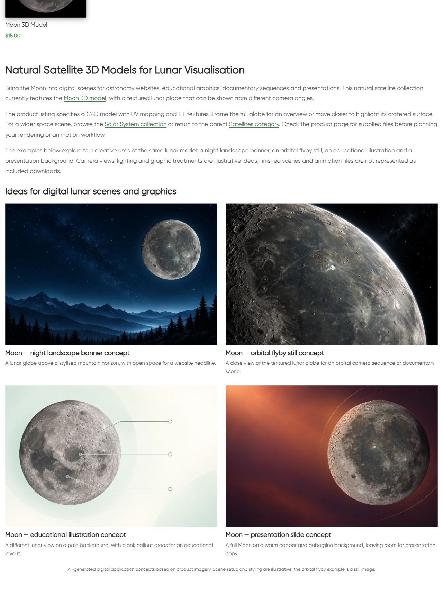

# Natural Satellites — описание и цифровые примеры

По поручению владельца продолжена следующая непустая категория. В исходной странице не было H1 и нижнего описания. Создан отдельный CMS block **22853** для term176: один H1, три абзаца, три направления ссылок и четыре примера, изображения и заголовки которых ведут на Moon 3D Model.

Примеры: ночной баннер с горным пейзажем, крупный орбитальный кадр, учебная иллюстрация с другим ракурсом Луны, фон презентации в медно-фиолетовых тонах. Каталог содержит одну модель Луны; другие спутники не представлены как доступные товары. Свежая карточка HTTP200 и четыре оригинальных изображения проверены. Подтверждены C4D, UV mapping и TIF textures; универсальная совместимость и лицензионные обещания не добавлены.

Built-in image_gen.imagegen применён с четырьмя оригинальными изображениями товара как референсами. Точные промпты, референсы и пути исходных PNG находятся в image-prompts.json; originals сохранены в generated/ и references/. PIL использован только для RGB/WebP88 conversion. Четыре изображения 1536×1024. Визуальная сверка с изображениями товара выполнена. Это AI-концепции применения, не фактические рендеры из скачанного C4D файла. На странице есть соответствующая подпись; орбитальный пример прямо обозначен как статичный кадр. Научная точность сцены, готовые анимации или комплектные сцены не обещаются.

| Пример | Attachment | Изображение |
|---|---|---|
| night-banner | 22854 | https://shustrik-maps.com/wp-content/uploads/2026/10/natural-satellites-night-banner-20261012.webp |
| orbital-frame | 22855 | https://shustrik-maps.com/wp-content/uploads/2026/10/natural-satellites-orbital-frame-20261012.webp |
| learning-graphic | 22856 | https://shustrik-maps.com/wp-content/uploads/2026/10/natural-satellites-learning-graphic-20261012.webp |
| presentation-slide | 22857 | https://shustrik-maps.com/wp-content/uploads/2026/10/natural-satellites-presentation-slide-20261012.webp |

GitHub-first fetch, SSH remote, main и upstream0:0 проверены. Шесть посторонних modified files и существующие untracked материалы сохранены. Исходный commit **e6126418ffa04d1b2055e153cc53744e3f6b6a8f** отправлен в GitHub до публикации. Точный архив SHA256 **4dbb9cacbd01f536a235cb005c385f4fa3c5d17b7ad794f35b86b82b7aa1e2ee** проверен на сервере. Внешний target https://shustrik-maps.com; WireGuard vpsadmin@10.66.66.1, sudo Docker, WordPress source `/tmp/natural-satellites-e6126418ffa0`. PHP lint и preview прошли; apply выполнен один раз **2026-10-12T05:40:26+00:00**.

Backup и media journal сохранены до импорта. Публикация использовала условную SQL-транзакцию и исходные protected hashes. Изменены только два metadata значения term176: category_extra_description_type=text→html_block и category_extra_description_html_block=empty→22853. Исходное пустое text-поле и description сохранены. Добавлены один отдельный block и четыре media attachment. SHA256 установленного содержимого **73afb8d0fc470e8c3bce047ebbaa68a3c36b39c052f33329f4b7e35f37dc93e1**. Прежние изображения сохранены. PHP512MiB — только для разового CLI процесса; постоянная конфигурация, build и restart не менялись.

Проверены неизменность товара и состава каталога (кроме generated CSS cache), остальных полей term/meta и **14** ранее опубликованных/shared blocks, включая 14416 и предыдущую Satellites. Verify и rollback-preview прошли. Реальный rollback не выполнялся.

Public QA: category/home/cart HTTP200, пустой checkout→cart200; три направления ссылок200, четыре media200, alt/hash/dimensions. Title, description meta, canonical, robots и schema types сохранены, как и одна карточка/цена/URL и отсутствие pagination. Один H1, четыре изображения, восемь article anchors и AI disclosure подтверждены. Первое чтение сразу после публикации вернуло старую кешированную страницу; повторное чтение подтвердило новый блок, без повторной публикации.

Browser QA: desktop1280×900 — две колонки; mobile390×844 — одна колонка, все изображения загружены/opacity1, горизонтального overflow нет. Проверены мобильные заголовок, четыре примера и подпись. Скриншоты опубликованной страницы сохранены.

Runtime 12.10.2026 08:43 МСК: SSH/sudoDocker available, WordPress и DB running, restart_count0, StartedAt2026-08-28 без изменений. Общий статус проекта yellow/degraded и P1 consent/recovery/analytics сохранены; paid guard03fc676 не менялся. Проверены только этот сайт и пустая корзина, покупки/оплаты не выполнялись. Полная schema validation, SEO-эффект и поисковая индексация не аттестованы.

Rollback backup `_shustrik_natural_satellites_backup_20261012`. В WordPress container: `php -d memory_limit=512M /tmp/natural-satellites-e6126418ffa0/release.php --rollback`. Условно восстанавливает type=text и empty block placement, сохраняя новый block/media и оригинальные материалы. После rollback требуется проверить публичную страницу.

[Мобильный заголовок](published-mobile-heading.png) · [Первый пример](published-mobile-first.png) · [Средние примеры](published-mobile-middle.png) · [Последний и подпись](published-mobile-last.png)
