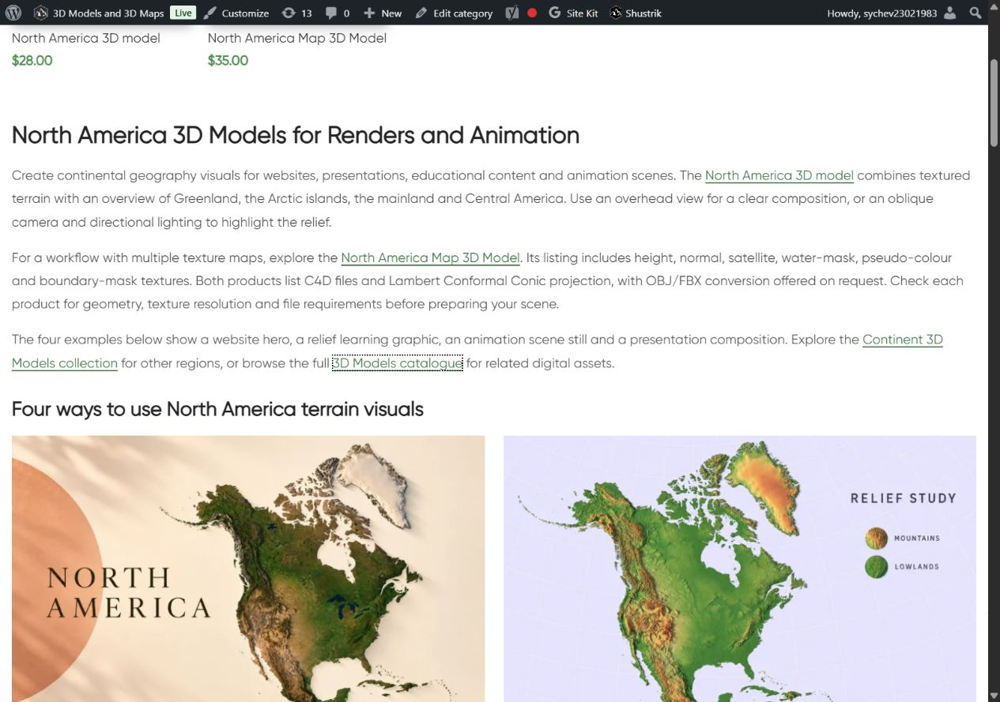

# North America Digital — описание и цифровые примеры

Owner requested next category. Updated existing dedicated category block14996/term159:single H1,three paragraphs,4 linked destinations,four linked image/title pairs and visible AI disclosure. Original catalogue 2 cards/prices/URLs and absence of pagination preserved. Examples:

- North America — website hero; source https://shustrik-maps.com/product/north-america-3d-model/
- North America — relief learning graphic; source https://shustrik-maps.com/product/north-america-3d-model/
- North America — animation scene still; source https://shustrik-maps.com/product/north-america-3d-model-terrain/
- North America — presentation graphic; source https://shustrik-maps.com/product/north-america-3d-model-terrain/

Fresh HTTP200 card details in product-reference-qa.json. Original product images inspected before built-in image_gen.imagegen reference-guided generation;exact prompts/reference paths/generated PNG paths in image-prompts.json. Original references and final PNGs retained;presentation image edited with built-in imagegen to remove extra text; initial variant retained at its recorded generated path. Persistent owner rule single-model categories text-only remains;current category has two models;PIL onlyRGB/WebP88conversion,four1536×1024assets. Creative backgrounds/light/composition,not actual supplied model-file renders/finished scenes. Animation example explicitly still. No universal formats,licensing,metric/scientific accuracy promises.  Visual comparison with original card images completed.

| Example | Attachment | Published media |
|---|---|---|
| website-hero | 22872 | https://shustrik-maps.com/wp-content/uploads/2023/09/north-america-digital-website-hero-20261012.webp |
| relief-learning | 22873 | https://shustrik-maps.com/wp-content/uploads/2023/09/north-america-digital-relief-learning-20261012.webp |
| animation-still | 22874 | https://shustrik-maps.com/wp-content/uploads/2023/09/north-america-digital-animation-still-20261012.webp |
| presentation-graphic | 22875 | https://shustrik-maps.com/wp-content/uploads/2023/09/north-america-digital-presentation-graphic-20261012.webp |

GitHub-first fetch/SSH/main/upstream0:0;unrelated modified/untracked preserved. Source **a3f1e17ab10c513701082eb613eeb686be1f09fd** pushed before CMS mutation;exact archive SHA256 **84429e09f91750979fcaeb71bfd27dcf3899e423c76e3a0fe15e19fee638320c** verified remote. External https://shustrik-maps.com via WireGuard vpsadmin@10.66.66.1/sudoDocker,source `/tmp/north-america-digital-a3f1e17ab10c`. PHP lint/preview passed,apply once **2026-10-12T08:11:38+00:00**. Backup/journal before import,conditionalSQL content transaction with exact before/protected guards. Only existing introductory content/modified time changed;no placement/newblock. Exact trailing shortcode row for six country/region blocks15267/15269/15271/15364/15346/15361 retained in published content; all six headings confirmed in desktop/mobile DOM. InstalledSHA256 **bcb640fb746195d30d24b455cefb173829ef3855ee536e2f2a39ace624f3b80f**. Original media retained;CLI512MiB only,no persistent config/build/restart.

Protected 2 product states except generated CSS cache,term fields/meta/description,block identity/meta and 28 prior posts (25CMS blocks/three menu items),including six retained country/region blocks. Published Continents term63/block22867 and North/South Pole text terms67/68 protected. Exact WordPress html_block parser guard confirms dedicated14996 reference only in term159.description;no other term/post/meta usage. block-usage-qa.json records scope.

Public category/home/cart200,emptycheckout→cart200;4 destinations200/fourmedia200/alt/hash/dimensions. Title/meta/canonical/robots/schema types/cards/prices preserved. One category H1,copy/four images/eight article anchors/AI disclosure verified. Six retained regional headings confirmed in both native viewports. Desktop1280 two columns,mobile390 one,nooverflow,allimagesloaded/opacity1. Native mobile viewport sequence. Verify/rollback-preview passed,actualrollback not executed. HTTP timeout/cache resolved by fresh read if encountered;no repeated apply. SSH/sudoDocker available,WP/DBrunning,restarts0,StartedAt2026-08-28 unchanged. Orders/payments0;full schema validation,consent,purchaseprocessing,SEO uplift/index updates outside scope. P1analytics/recovery/consent,yellow/degraded/priority/paidguard03fc676 retained.

Rollback backup `_shustrik_north_america_digital_backup_20261012`;inWordPresscontainer `php -d memory_limit=512M /tmp/north-america-digital-a3f1e17ab10c/release.php --rollback` conditionally restores original contentSHA256 **cc69b757cbd4fcf15a4e1e02b510ab250e1d2f6df4f5c526e5df33ed2d133283**,retainsmedia/block/reference. FollowpublicQA.

[Desktop examples/disclosure](published-desktop-last.jpg)

[Mobile heading](published-mobile-heading.jpg) · [Hero](published-mobile-first.jpg) · [Learning](published-mobile-learning.jpg) · [Animation](published-mobile-animation.jpg) · [Presentation/disclosure](published-mobile-last.jpg)
