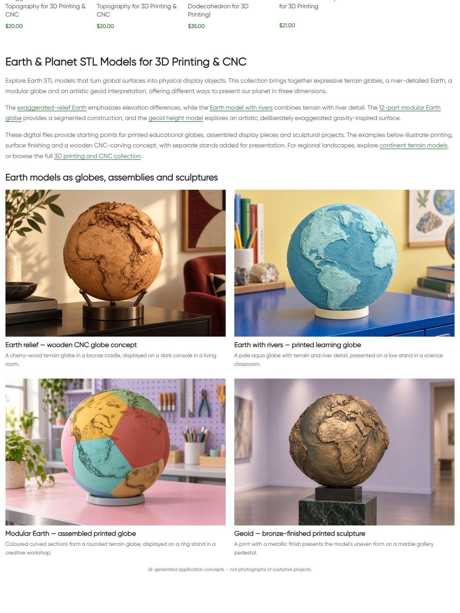
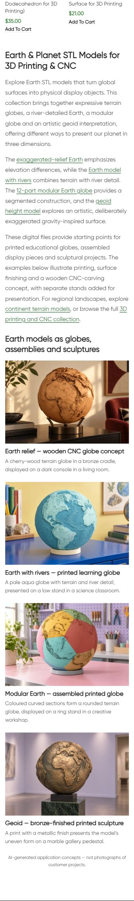

# Live QA — Planets

По поручению владельца продолжить следующий раздел и менять интерьер или физические изделия обновлён нижний block21162 категории term30. Опубликовано 11.10.2026 17:24:09 МСК. Один H1 **Earth & Planet STL Models for 3D Printing & CNC**, три описательных абзаца, шесть контекстных ссылок и четыре новых reference-based примера. Иллюстрации и заголовки ведут в соответствующие карточки.

## Четыре новых примера

- Earth relief: деревянный CNC globe concept из cherry wood, бронзовая опора и тёмная консоль в гостиной.
- Earth rivers: голубой печатный глобус с river detail на низкой подставке в учебном кабинете.
- Modular Earth: собранный округлый глобус с цветными curved pentagonal sections в творческой мастерской.
- Geoid: художественный геоид с неровной поверхностью, печатная скульптура с bronze finish на мраморном gallery pedestal.

Все четыре изображения созданы встроенным **image_gen.imagegen**, по одному исходному рендеру соответствующего товара. Reference files, точные prompts и mode сохранены в [image-prompts.json](image-prompts.json). Сгенерированные изображения просмотрены и сверены с референсами: сохранены характерные формы, ориентация, расположение материков и относительный рельеф; модульный globe округлый с pentagonal seams, геоид — artistic gravity-inspired form; фактическая STL/manufacturing точность не проверялась. Подставки, cradles и metallic finish — дополнительное оформление, не включение в цифровой файл. На странице явная подпись AI-generated application concepts, не customer project photographs. Каждый WebP1536×1024; PIL использован только для конвертации в RGB/WebPquality88.

| Модель | Новое attachment | Сохранённые файлы |
|---|---|---|
| Earth-Relief |22813 |[WebP](assets/planets-category-earth-relief-20261011.webp) / [PNG](assets/earth-relief-original.png) |
| Earth-Rivers |22814 |[WebP](assets/planets-category-earth-rivers-20261011.webp) / [PNG](assets/earth-rivers-original.png) |
| Modular-Earth |22815 |[WebP](assets/planets-category-modular-earth-20261011.webp) / [PNG](assets/modular-earth-original.png) |
| Geoid |22816 |[WebP](assets/planets-category-geoid-20261011.webp) / [PNG](assets/geoid-original.png) |

## Исходники и публикация

GitHub SSH/main/fetch/HEAD/upstream0:0 проверены; unrelated dirty сохранены. Source **08e139730d423e6b9705528596a8d831e9f9bb4f** pushed. Exact Git archive SHA256 **11f1dfa703703a5f999e037542878dc673f5b076b4df8b260bc43db2addf9c85** совпал после передачи. External target https://shustrik-maps.com, established WireGuard vpsadmin@10.66.66.1, existing WordPress container. Source `/tmp/planets-category-08e139730d42`. PHP lint, single-term shared-usage check, hashes, preview прошли. Backup до import/write, apply один раз, conditional write. Installed content SHA256 **1ab40cfb1ca395d216d5e2d51e7a547db8dbec5ba42b6d24645d7a2da47a8b48**.

## Проверки

| Проверка | Результат | Доказательство |
|---|---|---|
| HTTP |Category/home/cart200; пустой checkout→cart200 |public-qa.json |
| H1/body |Один новый H1, блок присутствует, старый body заменён |public-qa.json / screenshots |
| SEO title/meta/canonical/robots |Exact baseline values сохранены |public-baseline.json / public-qa.json |
| Schema |Types/mechanism сохранены; full validation вне scope |public-qa.json |
| Каталог |Все четыре карточек/URL/заголовков/цен exact, пагинации нет |public-qa.json |
| Product references |Четыре выбранные карточки HTTP200, H1/source media recorded, original renders inspected |product-reference-qa.json |
| Links/CTA |Шесть unique endpoints200, четыре photo/title pairs корректны |public-qa.json |
| Media |Четыре HTTP200/alt, loaded desktop/mobile, file hash/dimensions exact |verify.json / browser-qa.json |
| Desktop/mobile |1280px две колонки,390px одна, overflowfalse; screenshots inspected |browser-qa.json |
| Protected DB |Четыре products,term/block meta, прежние blocks14417/21177/21176/21175/21178 hashes сохранены |baseline.json / verify.json |
| Runtime |SSH/sudoDocker available,WP/DBrunning/restarts0/StartedAt прежние |runtime-after.json |
| Rollback |Guarded preview passed, откат не выполнялся |rollback-preview.json |

Первый публичный запрос получил старую page-cache версию. После background refresh final checks passed; повторного apply,global cache purge,build/restart нет. Orders/payments0. GET health не подтверждает оплату. SEO uplift/index update, научная точность geoid,фактическое изготовление,purchase processing и consent не проверялись. P1 analytics/recovery/consent,yellow/degraded,priority и paid guard source03fc676 сохранены. Другие проекты не аттестованы.

## Резервная копия

Backup `_shustrik_planets_category_backup_20261011`, media journal `_shustrik_planets_category_media_20261011`. Условный откат: `php /tmp/planets-category-08e139730d42/release.php --rollback` внутри того же WordPress container через SSH/sudoDocker. Guard проверяет installed content/protected hashes; восстанавливается прежний блок, media сохраняются. После отката — публичная проверка.

## Опубликованная страница

