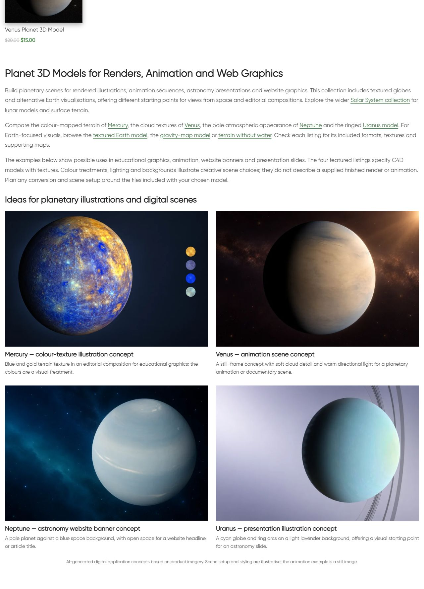

# Planets Digital — описание и цифровые примеры

Owner requested next category. Updated existing bottom block17235/term86:single H1,three paragraphs,8 linked destinations,four linked image/title pairs and visible AI disclosure. Original catalogue 11 cards/prices/URLs and absence of pagination preserved. Examples:

- Mercury - colour-texture illustration concept; source https://shustrik-maps.com/product/mercury-planet-3d-model/
- Venus - animation scene still concept; source https://shustrik-maps.com/product/venus-planet-3d-model/
- Neptune - website banner concept; source https://shustrik-maps.com/product/neptune-planet-3d-model/
- Uranus - presentation illustration concept; source https://shustrik-maps.com/product/uranus-3d-model/

Fresh HTTP200 card details in product-reference-qa.json. Original product images inspected before built-in image_gen.imagegen reference-guided generation;exact prompts/reference paths/generated PNG paths in image-prompts.json. Original references and PNGs retained;PIL onlyRGB/WebP88conversion,four1536×1024assets. Creative backgrounds/light/composition,not actual supplied model-file renders/finished scenes. Animation example explicitly still. No universal formats,licensing,metric/scientific accuracy promises. Mercury colour texture illustrative when present. Visual comparison with original card images completed.

| Example | Attachment | Published media |
|---|---|---|
| mercury-education | 22845 | https://shustrik-maps.com/wp-content/uploads/2024/07/planets-digital-mercury-education-20261011.webp |
| venus-animation | 22846 | https://shustrik-maps.com/wp-content/uploads/2024/07/planets-digital-venus-animation-20261011.webp |
| neptune-banner | 22847 | https://shustrik-maps.com/wp-content/uploads/2024/07/planets-digital-neptune-banner-20261011.webp |
| uranus-presentation | 22848 | https://shustrik-maps.com/wp-content/uploads/2024/07/planets-digital-uranus-presentation-20261011.webp |

GitHub-first fetch/SSH/main/upstream0:0;unrelated modified/untracked preserved. Source **a2a6d62ac7f0ef92b1abca6bd8a8ecfb227eb48e** pushed before CMS mutation;exact archive SHA256 **952af09ec12533cdabb7bee51ea1fadfb1f84f4cc55c1036cc040a0fbb832218** verified remote. External https://shustrik-maps.com via WireGuard vpsadmin@10.66.66.1/sudoDocker,source `/tmp/planets-digital-a2a6d62ac7f0`. PHP lint/preview passed,apply once **2026-10-11T18:08:23+00:00**. Backup/journal before import,conditionalSQL content transaction with exact before/protected guards. Only existing bottom content/modified time changed;no placement/newblock. InstalledSHA256 **6cc5a09c60ec729266b88e7ff067d7574c041ab1944f13c4ed0264bae06011b2**. Original media retained;CLI512MiB only,no persistent config/build/restart.

Protected 11 product states except generated CSS cache,term fields/meta/description,block identity/meta and 12 prior blocks including root/preceding categories. Exact shortcode usage guard;Planets broad digit match in Florida product17994 was only `vc_custom_1723526429411` timestamp,no actual html_block reference. block-usage-qa.json when present.

Public category/home/cart200,emptycheckout→cart200;8 destinations200/fourmedia200/alt/hash/dimensions. Title/meta/canonical/robots/schema types/cards/prices preserved. One bottom H1,copy/four images/eight article anchors/AI disclosure verified. Desktop1280 two columns,mobile390 one,nooverflow,allimagesloaded/opacity1. Native mobile viewport sequence. Verify/rollback-preview passed,actualrollback not executed. HTTP timeout/cache resolved by fresh read if encountered;no repeated apply. SSH/sudoDocker available,WP/DBrunning,restarts0,StartedAt2026-08-28 unchanged. Orders/payments0;full schema validation,consent,purchaseprocessing,SEO uplift/index updates outside scope. P1analytics/recovery/consent,yellow/degraded/priority/paidguard03fc676 retained.

Rollback backup `_shustrik_planets_digital_backup_20261011`;inWordPresscontainer `php -d memory_limit=512M /tmp/planets-digital-a2a6d62ac7f0/release.php --rollback` conditionally restores original contentSHA256 **c2cd2a0494dc8d4f26b382cf3162554b5ea21beedaa04987b826b267921947a6**,retainsmedia/block/reference. FollowpublicQA.

[Mobile heading](published-mobile-heading.png) · [First](published-mobile-first.png) · [Middle](published-mobile-middle.png) · [Last/disclosure](published-mobile-last.png)
