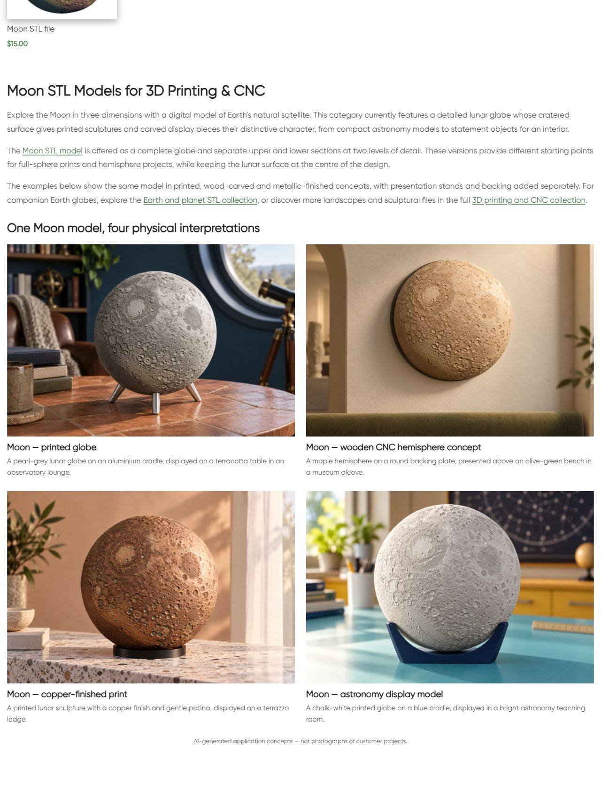
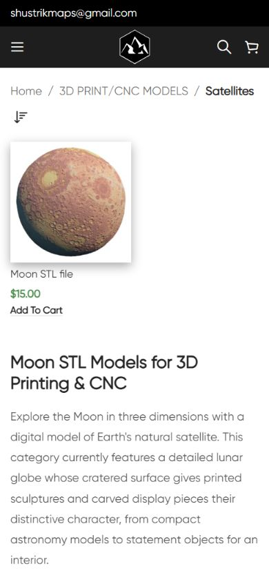

# Live QA — Satellites

По поручению владельца продолжить категории и менять интерьеры/физические изделия опубликован новый нижний block22817/term175: **Moon STL Models for 3D Printing & CNC**, три абзаца, три contextual endpoints и четыре новых примера. Публикация 11.10.2026 17:52:29 МСК. В категории один товар Moon16131; все четыре пары изображение/заголовок ведут в его карточку. Текст точно описывает имеющийся lunar assortment, whole globe/upper/lower parts at two detail levels; нет обещаний других спутников.

## Изображения и промпты

Встроенный **image_gen.imagegen**, четыре отдельные генерации по оригинальному Moon render. Референс просмотрен; в результатах визуально сохранены шар/полусфера, крупный бассейн сверху слева, характерные мелкие кратеры. Изменены материалы и обстановка: серый print/aluminium cradle/observatory lounge; maple CNC hemisphere/museum bench; copper-finished print/terrazzo apartment ledge; white print/astronomy teaching room. Exact prompts, absolute reference/source paths и built-in mode: [image-prompts.json](image-prompts.json). Stand/backing/finish — дополнительное оформление. Это AI concepts, на сайте видимая подпись; изготовление и метрическая точность STL не проверялись. PIL использован только для RGB/WebP88 conversion;1536×1024. PNG originals retained.

| Пример | Attachment | Файлы |
|---|---|---|
| moon-print |22818 |[WebP](assets/satellites-category-moon-print-20261011.webp) / [PNG](assets/moon-print-original.png) |
| moon-cnc |22819 |[WebP](assets/satellites-category-moon-cnc-20261011.webp) / [PNG](assets/moon-cnc-original.png) |
| moon-copper |22820 |[WebP](assets/satellites-category-moon-copper-20261011.webp) / [PNG](assets/moon-copper-original.png) |
| moon-study |22821 |[WebP](assets/satellites-category-moon-study-20261011.webp) / [PNG](assets/moon-study-original.png) |

## Публикация и восстановление

GitHub SSH/main/fetch/upstream0:0 подтверждены, unrelated dirty сохранены. Опубликованный source **173f7ce3ac63aa8754536fa7cf52672bfa2b15a0**, exact archive SHA256 **745f979c33ba914c11b1056bf35b582c0aa716e282021307f608c44a37875687**, target external https://shustrik-maps.com, established VPN/SSH/sudoDocker/existing WordPress container. Source `/tmp/satellites-category-173f7ce3ac63`. Installed content SHA256 **10c246c6dfdf4f99306166c323b26e297662578cd2fcde46a4525f5b16de96ee**. Единственное подключение нижнего блока — publish-ready 17:52:29 МСК. Два term metadata fields: category_extra_description_type text→html_block и category_extra_description_html_block empty→22817. Остальные term data/SEO/catalogue сохранены.

Первоначальный WordPress CLI256MiB process остановился после создания пустого draft22817: category placement оставался text/empty,media0. Состояние и backup проверены, выполнено guarded resume того же черновика при one-off CLI512MiB. Постоянная конфигурация памяти не изменялась. WordPress save filter затем удалил vc_raw_html; transaction guard остановил подключение и сохранил четыре imported media22818–22821. После проверки exact ready state применён conditional SQL block-content/placement transaction; дубли блоков/media не создавались. [prepared-state-recovery.json](prepared-state-recovery.json).

Полный product hash изменился между снимками; raw title/excerpt/body и modified date дополнительно проверены, HTML-stripped whitespace-normalized текст совпадает с аудитом10.10. Original hash-only snapshot не позволяет восстановить точный первый metadata diff. [product-guard-refresh.json](product-guard-refresh.json). После public GET повторная проверка доказала единственное различие от проверенного состояния — runtime cache key wd_page_css_files; исключение ровно этого ключа восстанавливает exact guard f66728a0b36953f5725bdfac27bc94e46f5cdbf84bcd87928cd6fc935e2f7535. [product-css-cache-proof.json](product-css-cache-proof.json). Все прочие product post/metadata защищены и совпадают с проверенным snapshot. Товар этим выпуском не редактировался.

QA/rollback tools source **e5f7a910b61b72a3a27c1c94047bbe35c7cb4822**, SHA256 archive **2499b90c8f50810d9b149a36053c3f5fac1f0c2a21fb38443abca7c9d82a3f1b**, `/tmp/satellites-category-e5f7a910b61b`; update только guard cache, без повторной публикации CMS. `deployment.json` относится к последнему QA-tools archive, `published-source.json` фиксирует фактический publish source.

## Проверки

| Проверка | Результат |
|---|---|
| HTTP |Category/home/cart200; пустой checkout→cart200; public-qa.json |
| Copy/H1 |Один H1,3абзаца, четыре image/title pairs и AI disclosure |
| SEO |Title/meta/canonical/robots/schema types exact baseline сохранены; новый schema не добавлялся |
| Catalogue |Одна карточка/URL/title/price exact, pagination absent |
| Links/media |Три endpoints200, четыре media200/alt/hash1536×1024, loaded/opacity1 на обоих размерах |
| Desktop/mobile |1280px две колонки;390px одна; overflowfalse, screenshots visually checked |
| Protected DB |Term175 кроме двух placement fields; Moon16131 except generated CSS cache; все шесть прежних blocks14417/21177/21176/21175/21178/21162 совпадают |
| Runtime |SSH/sudoDocker available;WP/DBrunning/restarts0/StartedAt2026-08-28 unchanged |
| Rollback |Guarded rollback-preview passed; rollback не выполнялся |

Browser tab сначала показывал прежнюю cached page; reload отобразил новую. No build/restart/global cache purge. Mobile full-page screenshot API оказался unavailable; сохранена последовательность native viewport captures. All four physical examples inspected on mobile. Orders/payments0; GEThealth не подтверждает оплаты. SEO uplift/index update/actual fabrication/full schema validation/purchase processing/consent не проверялись. P1 analytics/recovery/consent, yellow/degraded,priority и paid guard03fc676 сохранены; другие проекты не аттестованы.

## Rollback

Backup `_shustrik_satellites_category_backup_20261011`, journal `_shustrik_satellites_category_media_20261011`. В WordPress container: `php -d memory_limit=512M /tmp/satellites-category-e5f7a910b61b/release.php --rollback`. Guard проверяет installed content, placement и protected state. Восстанавливает два исходных placement fields text/empty, сохраняя новый block/media. Затем повторить public QA.

## Скриншоты

[Printed globe](published-mobile-print.png) · [CNC hemisphere](published-mobile-cnc.png) · [Copper finish](published-mobile-copper.png) · [Study globe and disclosure](published-mobile-study.png)
