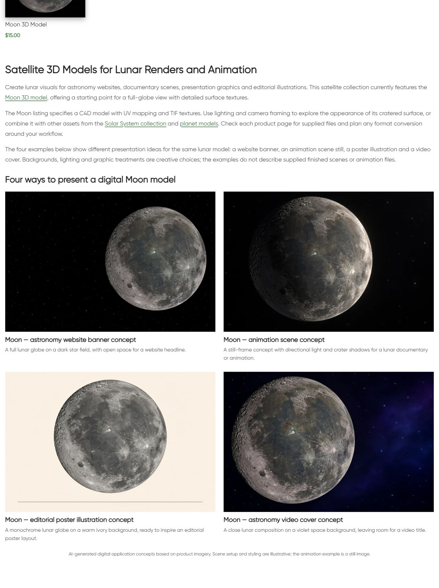

# Satellites Digital — описание и цифровые примеры

Owner requested next category. Updated existing bottom block18122/term171:single H1,three paragraphs,3 linked destinations,four linked image/title pairs and visible AI disclosure. Original catalogue 1 cards/prices/URLs and absence of pagination preserved. Examples:

- Moon - astronomy website banner concept; source https://shustrik-maps.com/product/moon-3d-model/
- Moon - animation scene still concept; source https://shustrik-maps.com/product/moon-3d-model/
- Moon - editorial poster illustration concept; source https://shustrik-maps.com/product/moon-3d-model/
- Moon - astronomy video cover concept; source https://shustrik-maps.com/product/moon-3d-model/

Fresh HTTP200 card details in product-reference-qa.json. Original product images inspected before built-in image_gen.imagegen reference-guided generation;exact prompts/reference paths/generated PNG paths in image-prompts.json. Original references and PNGs retained;PIL onlyRGB/WebP88conversion,four1536×1024assets. Creative backgrounds/light/composition,not actual supplied model-file renders/finished scenes. Animation example explicitly still. No universal formats,licensing,metric/scientific accuracy promises. Mercury colour texture illustrative when present. Visual comparison with original card images completed.

| Example | Attachment | Published media |
|---|---|---|
| moon-banner | 22849 | https://shustrik-maps.com/wp-content/uploads/2024/09/satellites-digital-moon-banner-20261012.webp |
| moon-animation | 22850 | https://shustrik-maps.com/wp-content/uploads/2024/09/satellites-digital-moon-animation-20261012.webp |
| moon-poster | 22851 | https://shustrik-maps.com/wp-content/uploads/2024/09/satellites-digital-moon-poster-20261012.webp |
| moon-video | 22852 | https://shustrik-maps.com/wp-content/uploads/2024/09/satellites-digital-moon-video-20261012.webp |

GitHub-first fetch/SSH/main/upstream0:0;unrelated modified/untracked preserved. Source **88481b5ed2253a01851f4c31a8278526e55517f6** pushed before CMS mutation;exact archive SHA256 **2f0e54d768df2219e17ff6554f5c5b54b9474f24dd5aa6ac16903f35223c411e** verified remote. External https://shustrik-maps.com via WireGuard vpsadmin@10.66.66.1/sudoDocker,source `/tmp/satellites-digital-88481b5ed225`. PHP lint/preview passed,apply once **2026-10-12T05:22:21+00:00**. Backup/journal before import,conditionalSQL content transaction with exact before/protected guards. Only existing bottom content/modified time changed;no placement/newblock. InstalledSHA256 **5632298fccedeff3911759aced3e1df1b0c5613d3b7131be2a79a4d6719cf19a**. Original media retained;CLI512MiB only,no persistent config/build/restart.

Protected 1 product states except generated CSS cache,term fields/meta/description,block identity/meta and 13 prior blocks including root/preceding categories. Exact shortcode usage guard;Planets broad digit match in Florida product17994 was only `vc_custom_1723526429411` timestamp,no actual html_block reference. block-usage-qa.json when present.

Public category/home/cart200,emptycheckout→cart200;3 destinations200/fourmedia200/alt/hash/dimensions. Title/meta/canonical/robots/schema types/cards/prices preserved. One bottom H1,copy/four images/eight article anchors/AI disclosure verified. Desktop1280 two columns,mobile390 one,nooverflow,allimagesloaded/opacity1. Native mobile viewport sequence. Verify/rollback-preview passed,actualrollback not executed. HTTP timeout/cache resolved by fresh read if encountered;no repeated apply. SSH/sudoDocker available,WP/DBrunning,restarts0,StartedAt2026-08-28 unchanged. Orders/payments0;full schema validation,consent,purchaseprocessing,SEO uplift/index updates outside scope. P1analytics/recovery/consent,yellow/degraded/priority/paidguard03fc676 retained.

Rollback backup `_shustrik_satellites_digital_backup_20261012`;inWordPresscontainer `php -d memory_limit=512M /tmp/satellites-digital-88481b5ed225/release.php --rollback` conditionally restores original contentSHA256 **06147ffe05a3145833c3b385ed38988c0f2baf2c2f62f6696c7de04ca1fdd3e5**,retainsmedia/block/reference. FollowpublicQA.

[Mobile heading](published-mobile-heading.png) · [First](published-mobile-first.png) · [Middle](published-mobile-middle.png) · [Last/disclosure](published-mobile-last.png)
