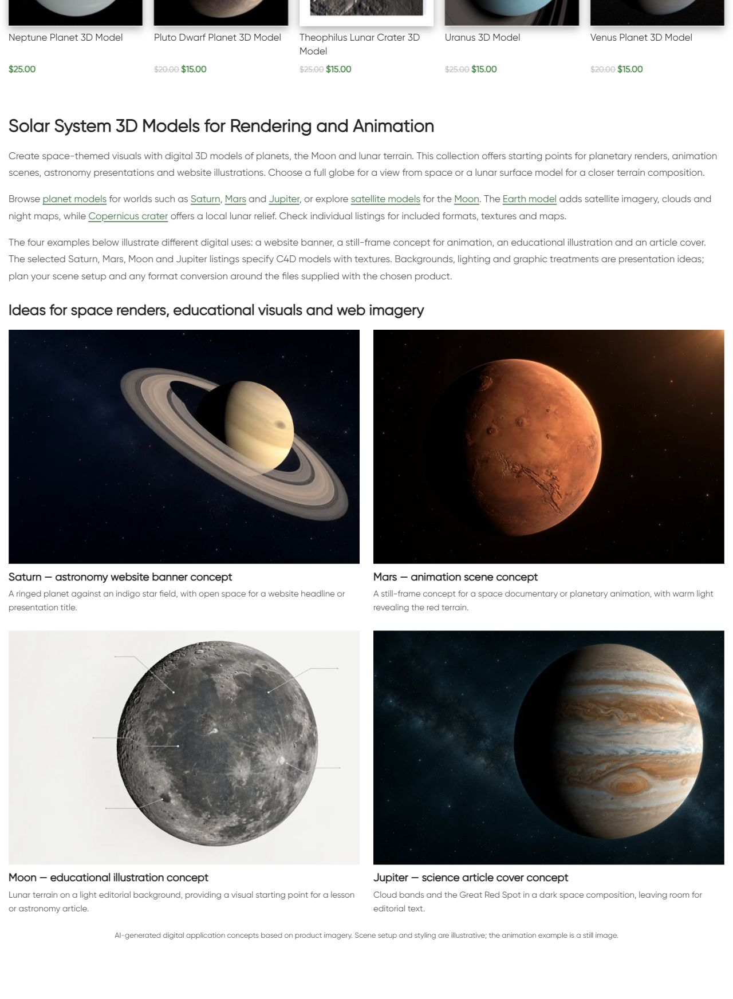

# Solar System — описание и цифровые примеры

По поручению владельца продолжить следующую категорию обновлён existing dedicated bottom block16359/term170. Новый единственный H1 **Solar System 3D Models for Rendering and Animation**,три абзаца,восемь contextual destinations,четыре linked image/title pairs. Сатурн — astronomy website banner;Марс — animation scene still;Луна — educational illustration;Юпитер — science article cover. Новые композиции/свет/фон соответствуют digital-use направлению,одобренному владельцем.15 catalogue product cards/prices preserved,no pagination.

## Изображения и карточки

Fresh HTTP200 product pages: Saturn16151,Mars16033,Moon16110,Jupiter16047. Each explicitly lists C4D with textures; no universal OBJ/export guarantee. Original product renders inspected before reference-guided **built-in image_gen.imagegen** generation. [product-reference-qa.json](product-reference-qa.json) records fetched details/source URLs;[image-prompts.json](image-prompts.json) exact prompts/reference paths/generated source paths. Original JPG references and PNGs retained. Four1536×1024WebP generated via PIL onlyRGB/WebP88conversion. Newattachment alt/caption/visible AI disclosure;animation explicitly still image. Visual reference comparison: Saturn ring plane/divisions and cream bands,Mars canyon pattern,Moon maria/craters,Jupiter bands/GreatRedSpot recognizable. Exact geometry/scientific accuracy not attested;concepts based on product imagery rather than actual model file renders. No supplied finished scene/animation claims. Original category image/media retained.

| Пример | attachment | Файлы |
|---|---|---|
| saturn-banner | 22841 | [WebP](assets/solar-system-saturn-banner-20261011.webp) / [PNG](assets/saturn-banner-original.png) |
| mars-animation | 22842 | [WebP](assets/solar-system-mars-animation-20261011.webp) / [PNG](assets/mars-animation-original.png) |
| moon-education | 22843 | [WebP](assets/solar-system-moon-education-20261011.webp) / [PNG](assets/moon-education-original.png) |
| jupiter-editorial | 22844 | [WebP](assets/solar-system-jupiter-editorial-20261011.webp) / [PNG](assets/jupiter-editorial-original.png) |

## Исходники и публикация

GitHub SSH/fetch/main/upstream0:0 confirmed,six unrelated modified files and pre-existing untracked preserved. Source **d9295c7752a4d66d4d6b332c8de48f87df8853a5** committed/pushed before CMS mutation. Exact Git archive SHA256 **bb85d3115a7cb6e9fafef18629df7a5e4659e9b3329d15fcfd84522cbd2573a2** verified remote. External https://shustrik-maps.com via established WireGuard vpsadmin@10.66.66.1/sudoDocker;source `/tmp/solar-system-d9295c7752a4`. PHP lint/preview passed;apply once **2026-10-11T17:33:53+00:00**. Backup/journal before media import;conditional SQL transaction updates only block16359 content/modified time after exact before and protected guards. InstalledcontentSHA256 **fe76eaa208a94e9c957504cd86dd57bb78c6de1f31c8c4e73e51e2af13ce7311**. No new block/category reference changes. Media upload paths use parent block2024/06 date;new attachment IDs22841–22844 verified. CLI memory512MiB only,no persistent config/build/restart.

Block usage guard confirms only term170 extra-description meta reference,no shared post/meta/description usage. Protected15 product post/meta states except generated CSS cache,term170 fields/meta and emptydescription,block16359 identity/meta,eleven prior blocks (shared14416,nineCNC,3DModels22832). Menus18204/20589 unchanged `[html_block id="14416"]`. Existing prior digital root content protected in full. Authored diff whitespace check passed.

## Проверки

- Public category/home/cart HTTP200;emptycheckout redirects cart200. Eight contextual endpoints200;fourmedia200/alt/hash/dimensions.
- Existing title/meta/canonical/robots/schema types,15cards/prices/URLs and absence of pagination preserved. One replacement bottom H1;there was no top H1 in baseline.
- Copy/four linked images,eight article anchors,AI disclosure checked. Initial HTTP check saw prior cached version;fresh check passed without repeated apply/global purge.
- Desktop1280 two columns;mobile390 one;allimagesloaded/opacity1,nooverflow. Native mobile viewport sequence checked fourimages and disclosure. Screenshots retained.
- SSH/sudoDocker available;WP/DBrunning,restarts0,StartedAt2026-08-28 unchanged. [runtime-after.json](runtime-after.json).
- Verify/rollback-preview passed. Actual rollback not executed. Orders/payments0;purchase processing,consent,full schema validation,SEOuplift/index updates outside scope. P1analytics/recovery/consent,yellow/degraded,priority/paidguard03fc676 unchanged.

## Rollback

Backup `_shustrik_solar_system_backup_20261011`;journal `_shustrik_solar_system_media_20261011`. In WordPress container: `php -d memory_limit=512M /tmp/solar-system-d9295c7752a4/release.php --rollback`. Conditional exact content/protected guards restore prior block contentSHA256 **c0d755a00cd98968e3201231fd3471975ddb8e3e2c93d0350abecb2c69ae97d7**,retainblock/media/category reference. ThenpublicQA.

## Скриншоты

[Mobile heading](published-mobile-heading.png) · [Saturn/Mars](published-mobile-first.png) · [Mars/Moon](published-mobile-middle.png) · [Jupiter/disclosure](published-mobile-last.png)
