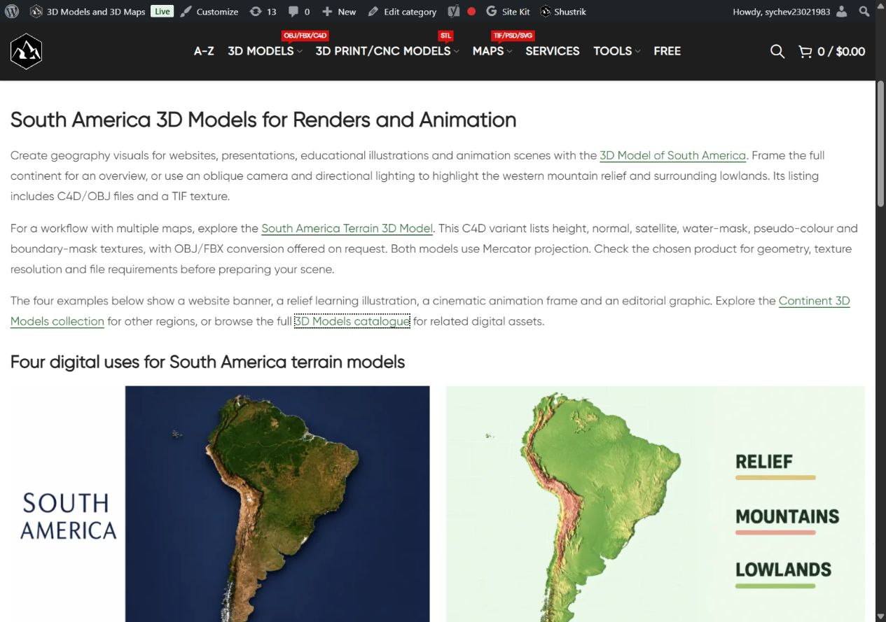

# South America Digital — описание и цифровые примеры

Owner requested next category. Updated existing dedicated category block15031/term160:single H1,three paragraphs,4 linked destinations,four linked image/title pairs and visible AI disclosure. Original catalogue 2 cards/prices/URLs and absence of pagination preserved. Examples:

- South America — website banner; source https://shustrik-maps.com/product/3d-map-of-south-america-c4d-model/
- South America — relief illustration; source https://shustrik-maps.com/product/south-america-3d-model-terrain/
- South America — animation frame; source https://shustrik-maps.com/product/3d-map-of-south-america-c4d-model/
- South America — editorial graphic; source https://shustrik-maps.com/product/south-america-3d-model-terrain/

Fresh HTTP200 card details in product-reference-qa.json. Original product images inspected before built-in image_gen.imagegen reference-guided generation;exact prompts/reference paths/generated PNG paths in image-prompts.json. Original references and final PNGs retained;All four new images visually compared with their original product references. Persistent owner rule single-model categories text-only remains;current category has two models;PIL onlyRGB/WebP88conversion,four1536×1024assets. Creative backgrounds/light/composition,not actual supplied model-file renders/finished scenes. Animation example explicitly still. No universal formats,licensing,metric/scientific accuracy promises.  Visual comparison with original card images completed.

| Example | Attachment | Published media |
|---|---|---|
| website-banner | 22876 | https://shustrik-maps.com/wp-content/uploads/2023/09/south-america-digital-website-banner-20261012.webp |
| relief-illustration | 22877 | https://shustrik-maps.com/wp-content/uploads/2023/09/south-america-digital-relief-illustration-20261012.webp |
| animation-frame | 22878 | https://shustrik-maps.com/wp-content/uploads/2023/09/south-america-digital-animation-frame-20261012.webp |
| editorial-layout | 22879 | https://shustrik-maps.com/wp-content/uploads/2023/09/south-america-digital-editorial-layout-20261012.webp |

GitHub-first fetch/SSH/main/upstream0:0;unrelated modified/untracked preserved. Source **69a146a203d9856fa495b08cd03b8ce90091d929** pushed before CMS mutation;exact archive SHA256 **60bb70b2ca290cd8639e3af7a0b459d735c5972a3908b8379de7bcc41c94427a** verified remote. External https://shustrik-maps.com via WireGuard vpsadmin@10.66.66.1/sudoDocker,source `/tmp/south-america-digital-69a146a203d9`. PHP lint/preview passed,apply once **2026-10-12T08:36:44+00:00**. Backup/journal before import,conditionalSQL content transaction with exact before/protected guards. Only existing introductory content/modified time changed;no placement/newblock. Exact trailing shortcode row for country collection block15273 retained in published content; all thirteen country collection headings confirmed in desktop/mobile DOM. InstalledSHA256 **bf09a43ab043340b328f31cd6e88fb6fd43ddad847d243d93221244665a95e51**. Original media retained;CLI512MiB only,no persistent config/build/restart.

Protected 2 product states except generated CSS cache,term fields/meta/description,block identity/meta and 30 prior posts (27CMS blocks/three menu items),including retained country collection block15273. Published Continents term63/block22867 and North/South Pole text terms67/68 and North America159 protected. Exact WordPress html_block parser guard confirms dedicated15031 reference only in term160.description;no other term/post/meta usage. block-usage-qa.json records scope.

Public category/home/cart200,emptycheckout→cart200;4 destinations200/fourmedia200/alt/hash/dimensions. Title/meta/canonical/robots/schema types/cards/prices preserved. One category H1,copy/four images/eight article anchors/AI disclosure verified. Thirteen retained country collection headings confirmed in both native viewports. Desktop1280 two columns,mobile390 one,nooverflow,allimagesloaded/opacity1. Native mobile viewport sequence. Verify/rollback-preview passed,actualrollback not executed. HTTP timeout/cache resolved by fresh read if encountered;no repeated apply. SSH/sudoDocker available,WP/DBrunning,restarts0,StartedAt2026-08-28 unchanged. Orders/payments0;full schema validation,consent,purchaseprocessing,SEO uplift/index updates outside scope. P1analytics/recovery/consent,yellow/degraded/priority/paidguard03fc676 retained.

Rollback backup `_shustrik_south_america_digital_backup_20261012`;inWordPresscontainer `php -d memory_limit=512M /tmp/south-america-digital-69a146a203d9/release.php --rollback` conditionally restores original contentSHA256 **9f9750c9fdf470dce45672fa6e6da60a1522dadba7a6f82fca694fd9b1a59961**,retainsmedia/block/reference. FollowpublicQA.

[Desktop examples/disclosure](published-desktop-last.jpg)

[Mobile heading](published-mobile-heading.jpg) · [Hero](published-mobile-first.jpg) · [Learning](published-mobile-learning.jpg) · [Animation](published-mobile-animation.jpg) · [Editorial/disclosure](published-mobile-last.jpg)
