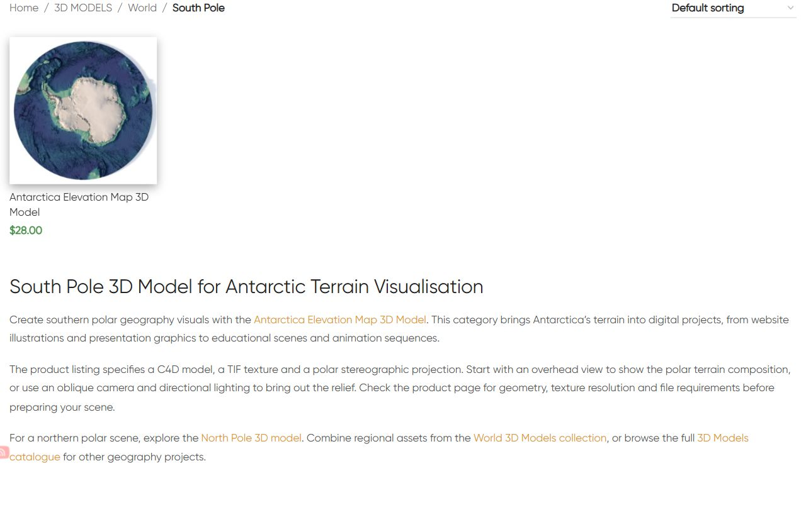

# South Pole — текстовое описание категории

По поручению владельца продолжена категория South Pole. Новое правило владельца от12.10.2026: в категориях с одной моделью оптимизировать только тексты, без добавления рендеров. Правило действует для текущей и дальнейшей работы. В текущей категории одна Antarctica Elevation Map 3D Model.

Заполнено существующее native bottom text поле category_extra_description_text term68: один H1 «South Pole 3D Model for Antarctic Terrain Visualisation», три коротких абзаца и четыре ссылки — модель Antarctica, North Pole, World и 3D Models. Текст описывает цифровое применение, выбор ракурса и проверенные C4D/TIF файлы и polar stereographic projection. Свежая карточка HTTP200; product-reference-qa.json содержит подтверждённые характеристики. Универсальные форматы, UV layer, научная точность и лицензии не обещаются.

В теме Woodmart проверен реальный путь отображения текста: inc/integrations/woocommerce/functions.php:2770–2808, wpautop/do_shortcode для type=text. Сохранены существующие type=text и пустая html_block ссылка. Изменено **только одно metadata значение** category_extra_description_text. Новые media attachment и CMS blocks не создавались; их исходные inventory counts защищены и подтверждены неизменными. Новые изображения не генерировались.

GitHub-first fetch/SSH remote/main/HEAD/upstream0:0 проверены. Шесть посторонних modified files и прежние untracked материалы сохранены. Source **abdec3ff632a5986ba93b8b2b73fd7959c9d4c77** отправлен в GitHub до публикации. Архив SHA256 **e39ea673e92f9f0c42062e825482569c5948e899f1e70880dfa0fefc6dca675a** проверен на сервере. External target https://shustrik-maps.com; WireGuard vpsadmin@10.66.66.1, sudo Docker, `/tmp/south-pole-text-abdec3ff632a`. PHP lint/preview прошли, apply один раз **2026-10-12T06:53:38+00:00**. Backup сохранён до условной SQL-транзакции; ожидаемое исходное значение пустое. SHA256 установленного текста **40320166e0136401083fe6a6ed0b20438a54cd824741822771099be73b2a9801**.

Protected: остальные term поля/meta/description/placement, один product state (кроме generated CSS cache), состав каталога, 17 прежних blocks, опубликованный North Pole term67 (включая текст) и количество attachments/CMS blocks. Verify/rollback-preview прошли; фактический rollback не выполнялся. CLI512MiB использовано только для разового процесса; постоянная конфигурация/build/restart не менялись.

Публичная проверка без авторизации: category/home/cart HTTP200, пустой checkout→cart200; четыре ссылки HTTP200. Исходные title, description meta, canonical, robots, schema types, одна карточка/цена/URL и отсутствие pagination сохранены. Один H1, три абзаца и отсутствие изображений в новом тексте подтверждены. Первое чтение вернуло прежнюю кешированную страницу, повторное чтение прошло без повторной публикации.

Browser QA в Chrome: desktop1280×900/mobile390×844, текст целиком проверен, horizontal overflow отсутствует. Скриншоты saved. Runtime 12.10.2026 09:55 МСК: SSH/sudoDocker available, WP/DB running, рестарты0, StartedAt2026-08-28 без изменений. Общий yellow/degraded, priority/high, P1 consent/recovery/analytics и paidguard03fc676 сохранены. Покупки/оплаты не выполнялись; SEO-эффект, индексация и полная schema validation не аттестованы.

Rollback backup `_shustrik_south_pole_text_backup_20261012`. В WordPress container: `php -d memory_limit=512M /tmp/south-pole-text-abdec3ff632a/release.php --rollback`. Условно восстанавливает исходное пустое native bottom text, оставляя остальные поля без изменений. После rollback проверить публичную страницу.

[Мобильная версия](published-mobile.png)
