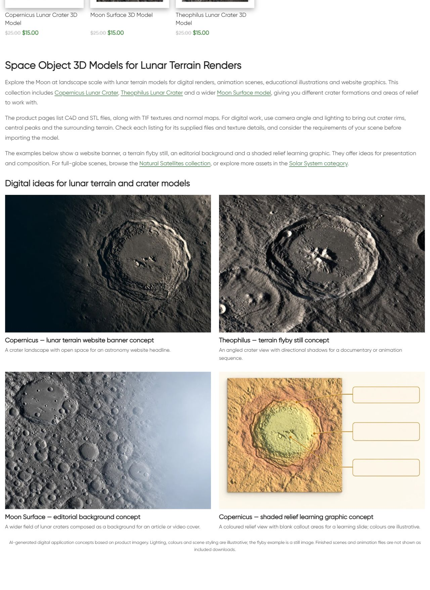

# Space objects — описание и цифровые примеры

По поручению владельца продолжена следующая непустая категория. В исходной странице не было H1 и нижнего описания. Создан отдельный CMS block **22858** для term200: один H1, три абзаца, пять направлений ссылок и четыре примера, изображения и заголовки которых ведут на соответствующие три карточки товаров.

Примеры: Copernicus как баннер сайта, Theophilus как кадр пролёта, Moon Surface как редакционный фон, Copernicus как цветная учебная иллюстрация. Каталог содержит три модели лунного рельефа. Все три свежие карточки HTTP200 проверены; исходные серые и цветные изображения просмотрены. Подтверждены C4D/STL, TIF textures и normal maps; универсальная совместимость, научная точность и лицензионные обещания не добавлены.

Built-in image_gen.imagegen применён с оригинальными изображениями трёх товаров как референсами. Точные промпты, референсы и пути исходных PNG находятся в image-prompts.json; originals сохранены в generated/ и references/. PIL использован только для RGB/WebP88 conversion. Четыре изображения 1536×1024. Визуальная сверка с изображениями товара выполнена. Это AI-концепции применения, не фактические рендеры из скачанного C4D файла. На странице есть соответствующая подпись; пример пролёта прямо обозначен как статичный кадр. Цвета учебной иллюстрации художественные. Научная точность сцены, готовые анимации или комплектные сцены не обещаются.

| Пример | Attachment | Изображение |
|---|---|---|
| copernicus-banner | 22859 | https://shustrik-maps.com/wp-content/uploads/2026/10/space-objects-copernicus-banner-20261012.webp |
| theophilus-flyby | 22860 | https://shustrik-maps.com/wp-content/uploads/2026/10/space-objects-theophilus-flyby-20261012.webp |
| moon-surface-graphic | 22861 | https://shustrik-maps.com/wp-content/uploads/2026/10/space-objects-moon-surface-graphic-20261012.webp |
| copernicus-learning | 22862 | https://shustrik-maps.com/wp-content/uploads/2026/10/space-objects-copernicus-learning-20261012.webp |

GitHub-first fetch, SSH remote, main и upstream0:0 проверены. Шесть посторонних modified files и существующие untracked материалы сохранены. Исходный commit **a4a52e77c4ec0ae79edeef7efda58a614fb9414b** отправлен в GitHub до публикации. Точный архив SHA256 **84dda9c81564cf98aa4664f6adea17194842dfd68d96a35935d7bf496e7430a0** проверен на сервере. Внешний target https://shustrik-maps.com; WireGuard vpsadmin@10.66.66.1, sudo Docker, WordPress source `/tmp/space-objects-a4a52e77c4ec`. PHP lint и preview прошли; apply выполнен один раз **2026-10-12T05:53:44+00:00**.

Backup и media journal сохранены до импорта. Публикация использовала условную SQL-транзакцию и исходные protected hashes. Изменены только два metadata значения term200: category_extra_description_type=text→html_block и category_extra_description_html_block=empty→22858. Исходное пустое text-поле и description сохранены. Добавлены один отдельный block и четыре media attachment. SHA256 установленного содержимого **59b283783c355902863104a62c10cceb81c8be25a2f0f216e3b35c2a476b7a48**. Прежние изображения сохранены. PHP512MiB — только для разового CLI процесса; постоянная конфигурация, build и restart не менялись.

Проверены неизменность трёх товаров и состава каталога (кроме generated CSS cache), остальных полей term/meta и **15** ранее опубликованных/shared blocks, включая 14416 и предыдущую Natural Satellites. Verify и rollback-preview прошли. Реальный rollback не выполнялся.

Public QA: category/home/cart HTTP200, пустой checkout→cart200; пять направлений ссылок200, четыре media200, alt/hash/dimensions. Title, description meta, canonical, robots и schema types сохранены, как и три карточки/цены/URL и отсутствие pagination. Один H1, четыре изображения, восемь article anchors и AI disclosure подтверждены. Первое чтение сразу после публикации вернуло старую кешированную страницу; повторное чтение подтвердило новый блок, без повторной публикации. Первый захват desktop screenshot не завершился; после свежей проверки страницы снимок сохранён.

Browser QA: desktop1280×900 — две колонки; mobile390×844 — одна колонка, все изображения загружены/opacity1, горизонтального overflow нет. Проверены мобильные заголовок, четыре примера и подпись. Скриншоты опубликованной страницы сохранены.

Runtime 12.10.2026 08:58 МСК: SSH/sudoDocker available, WordPress и DB running, restart_count0, StartedAt2026-08-28 без изменений. Общий статус проекта yellow/degraded и P1 consent/recovery/analytics сохранены; paid guard03fc676 не менялся. Проверены только этот сайт и пустая корзина, покупки/оплаты не выполнялись. Полная schema validation, SEO-эффект и поисковая индексация не аттестованы.

Rollback backup `_shustrik_space_objects_backup_20261012`. В WordPress container: `php -d memory_limit=512M /tmp/space-objects-a4a52e77c4ec/release.php --rollback`. Условно восстанавливает type=text и empty block placement, сохраняя новый block/media и оригинальные материалы. После rollback требуется проверить публичную страницу.

[Мобильный заголовок](published-mobile-heading.png) · [Первый пример](published-mobile-first.png) · [Средние примеры](published-mobile-middle.png) · [Последний и подпись](published-mobile-last.png)
