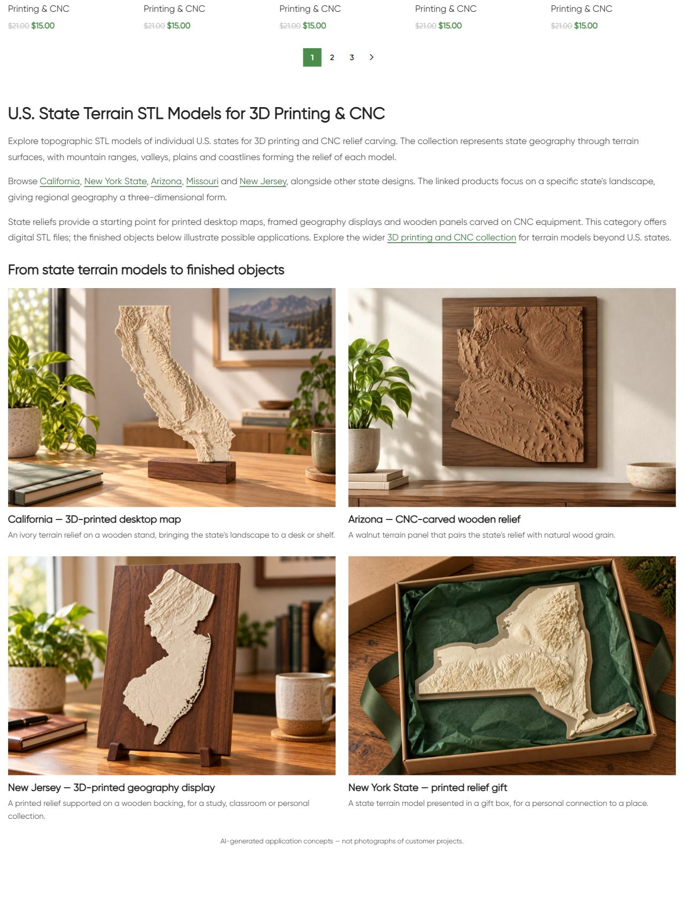
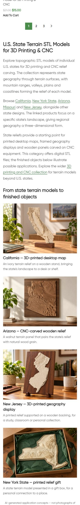

# Live QA — USA States

## Scope and evidence date

11.10.2026: владелец одобрил опубликованную CNC категорию и поручил перейти к следующей категории. Следующая подготовленная категория — USA States. Продолжен тот же workflow: H1 и профессиональное описание в нижней части, четыре примера изделий по карточкам товаров. Заменён только HTML block21177 категории term38; shared usage check подтвердил отсутствие других потребителей. Публикация один раз14:13:17МСК.

H1 **U.S. State Terrain STL Models for 3D Printing & CNC**, три абзаца с5ссылками на штаты и1на родительскую CNC категорию. Примеры: California — печатная настольная карта; Arizona — фрезерованный walnut relief; New Jersey — печатный geography display; New York State — printed relief gift. Фото и заголовки ведут в соответствующие карточки. Использованы4существующих AI-иллюстрации; новые media не импортировались, metadata reused attachments не менялись. На странице сохранено пояснение AI-generated application concepts.

Оригинальные рендеры карточек California/New York/New Jersey сверены с локальными источниками аудита10.10 и live product URLs. Attachment22806 Arizona — ранее одобренная иллюстрация CNC parent release. Это иллюстрации возможных применений; реальные STL, fabrication accuracy, tested compatibility и customer projects не проверялись и не заявлены. Title/meta, canonical, robots, taxonomy, цены, пагинация, товары и родительский блок14417 защищены baseline hashes/public checks. Technical universal claims из старого body удалены; отдельная meta proposal остаётся вне выпуска.

## Delivery and backup

GitHub-first: remoteSSH/main/fetch/upstream0:0 до source commit; прежние unrelated dirty сохранены. Source **a04c3f59739f66fcaa580db506c916ce1197a5fe** pushed и доставлен exact Git archive SHA256 **5ede74d17c1dc967cd560a4c754f05687a91aaddfbaca49379ae3cbe3e3c7874**. External target https://shustrik-maps.com; established WireGuard vpsadmin@10.66.66.1, WordPress container shustrik-maps-wordpress-1, source `/tmp/cnc-category-a04c3f59739f`. PHP lint и guarded preview прошли до apply; SQL conditional write изменил только content/modified dates блока.

Installed content SHA256 **2bdca6c7d0db8f42e8dda684c5acdc0b1b65b67f5f8140a29a4a393c51277e36**. Backup WordPress option `_shustrik_usa_category_backup_20261011`; journal `_shustrik_usa_category_media_20261011` с0new_media. Guarded rollback-preview passed. Для отката выполнить `php /tmp/cnc-category-a04c3f59739f/release.php --rollback` внутри того же WordPress container через established SSH/sudoDocker, затем повторить public QA. Guard проверяет установленный content hash и protected state; старые изображения сохраняются. Откат сейчас не выполнялся.

## Checks

| Check | Expected | Observed | Result | Evidence |
|---|---|---|---|---|
| HTTP | 200 | Category200, home/cart200, emptycheckout redirect cart200 | Passed | public-qa.json |
| robots/indexability | Preserve | index/follow прежний | Passed | public-baseline.json / public-qa.json |
| canonical | Preserve self | Category URL прежний | Passed | public-qa.json |
| H1/body | One new H1, approved scope | Один H1, новый body, прежний body заменён | Passed | category.html / browser screenshots |
| title/meta | Preserve | Exact baseline values | Passed | public-qa.json |
| schema | Preserve mechanism | Types unchanged; presence check, full schema validation outside scope | Passed within scope | public-qa.json |
| Catalogue/prices | Preserve |25cards первой страницы exact; page2HTTP200/25cards | Passed | public-qa.json |
| Context/product links |200,correct URLs |6unique endpoints200;4photo+heading pairs | Passed | public-qa.json |
| Media |4images,alt,load |4/4HTTP200/alt;4/4loaded desktop/mobile | Passed | public-qa.json / browser-qa.json |
| Desktop/mobile |2/1columns,no overflow |1280px2columns;390px1column;overflowfalse | Passed | browser-qa.json |
| Protected state | Unchanged | term/meta, selected5products,parentblock14417 hashes unchanged | Passed | verify.json |
| Runtime | Running | SSH/sudoDocker available,WP/DBrunning/restarts0/StartedAt unchanged | Passed | runtime-after.json |
| Rollback | Guarded readiness | Previewpassed,not executed | Passed | rollback-preview.json |

## Defects, unknowns and next action

Первые HTTP/browser checks показывали старую page-cache версию. После background refresh обычный публичный URL и единичная bypass-проверка показали новый блок. Final public QA passed; дополнительных cache mutations, build/restart и повторного apply нет. Реальных orders/payments0; GET commerce health не заменяет проверку оплаты.

SEO uplift, обновление индекса Google и processed purchase не измерены. P1 analytics/recovery/consent, yellow/degraded и приоритет проекта сохранены; paid guard остаётся03fc676. Другие приложения не аттестованы. Исторические записи «USA States draft» относятся к состоянию до этого выпуска. Следующий приоритет проекта — прежняя проверка consent, текущая контентная публикация завершена.

## Published screenshots

