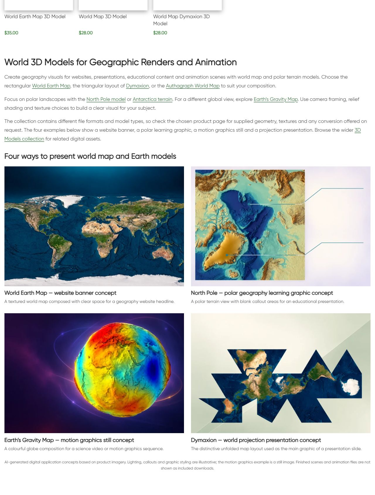

# World Digital — описание и цифровые примеры

Owner requested next category. Updated existing bottom block15975/term66:single H1,three paragraphs,7 linked destinations,four linked image/title pairs and visible AI disclosure. Original catalogue 8 cards/prices/URLs and absence of pagination preserved. Examples:

- World Earth Map — website banner concept; source https://shustrik-maps.com/product/world-3d-model/
- North Pole — polar geography learning graphic concept; source https://shustrik-maps.com/product/north-pole-3d-model/
- Earth’s Gravity Map — motion graphics still concept; source https://shustrik-maps.com/product/earths-gravity-map-3d-model/
- Dymaxion — world projection presentation concept; source https://shustrik-maps.com/product/world-map-dymaxion-3d-model/

Fresh HTTP200 card details in product-reference-qa.json. Original product images inspected before built-in image_gen.imagegen reference-guided generation;exact prompts/reference paths/generated PNG paths in image-prompts.json. Original references and PNGs retained;PIL onlyRGB/WebP88conversion,four1536×1024assets. Creative backgrounds/light/composition,not actual supplied model-file renders/finished scenes. Animation example explicitly still. No universal formats,licensing,metric/scientific accuracy promises.  Visual comparison with original card images completed.

| Example | Attachment | Published media |
|---|---|---|
| world-banner | 22863 | https://shustrik-maps.com/wp-content/uploads/2024/04/world-digital-world-banner-20261012.webp |
| north-pole-learning | 22864 | https://shustrik-maps.com/wp-content/uploads/2024/04/world-digital-north-pole-learning-20261012.webp |
| gravity-animation | 22865 | https://shustrik-maps.com/wp-content/uploads/2024/04/world-digital-gravity-animation-20261012.webp |
| dymaxion-slide | 22866 | https://shustrik-maps.com/wp-content/uploads/2024/04/world-digital-dymaxion-slide-20261012.webp |

GitHub-first fetch/SSH/main/upstream0:0;unrelated modified/untracked preserved. Source **32680e96c6926420e796d7c05dd615ae3500d2ab** pushed before CMS mutation;exact archive SHA256 **55e1f83fd5dc438a485115afa8a9e7a33724da2ea698bbf5e724f91d366c79ee** verified remote. External https://shustrik-maps.com via WireGuard vpsadmin@10.66.66.1/sudoDocker,source `/tmp/world-digital-32680e96c692`. PHP lint/preview passed,apply once **2026-10-12T06:08:25+00:00**. Backup/journal before import,conditionalSQL content transaction with exact before/protected guards. Only existing bottom content/modified time changed;no placement/newblock. InstalledSHA256 **26987eac4d16edf701776b3d59dcdcbfe0649053c1d2d00df83d48e738dcce33**. Original media retained;CLI512MiB only,no persistent config/build/restart.

Protected 8 product states except generated CSS cache,term fields/meta/description,block identity/meta and 16 prior blocks including root/preceding categories. Exact WordPress html_block shortcode parser guard. Broad digit match in Minsk product9386 was only `vc_custom_1665776159755` CSS timestamp; no actual block15975 reference. Fresh non-mutating query and block-usage-qa.json record this finding.

Public category/home/cart200,emptycheckout→cart200;7 destinations200/fourmedia200/alt/hash/dimensions. Title/meta/canonical/robots/schema types/cards/prices preserved. One bottom H1,copy/four images/eight article anchors/AI disclosure verified. Desktop1280 two columns,mobile390 one,nooverflow,allimagesloaded/opacity1. Native mobile viewport sequence. Verify/rollback-preview passed,actualrollback not executed. HTTP timeout/cache resolved by fresh read if encountered;no repeated apply. SSH/sudoDocker available,WP/DBrunning,restarts0,StartedAt2026-08-28 unchanged. Orders/payments0;full schema validation,consent,purchaseprocessing,SEO uplift/index updates outside scope. P1analytics/recovery/consent,yellow/degraded/priority/paidguard03fc676 retained.

Rollback backup `_shustrik_world_digital_backup_20261012`;inWordPresscontainer `php -d memory_limit=512M /tmp/world-digital-32680e96c692/release.php --rollback` conditionally restores original contentSHA256 **5ec8abe6c8d6fd5db0bb45a5e85a411f7525a01414c61b2dc62c3e121749e1fb**,retainsmedia/block/reference. FollowpublicQA.

[Mobile heading](published-mobile-heading.png) · [First](published-mobile-first.png) · [Middle](published-mobile-middle.png) · [Last/disclosure](published-mobile-last.png)
